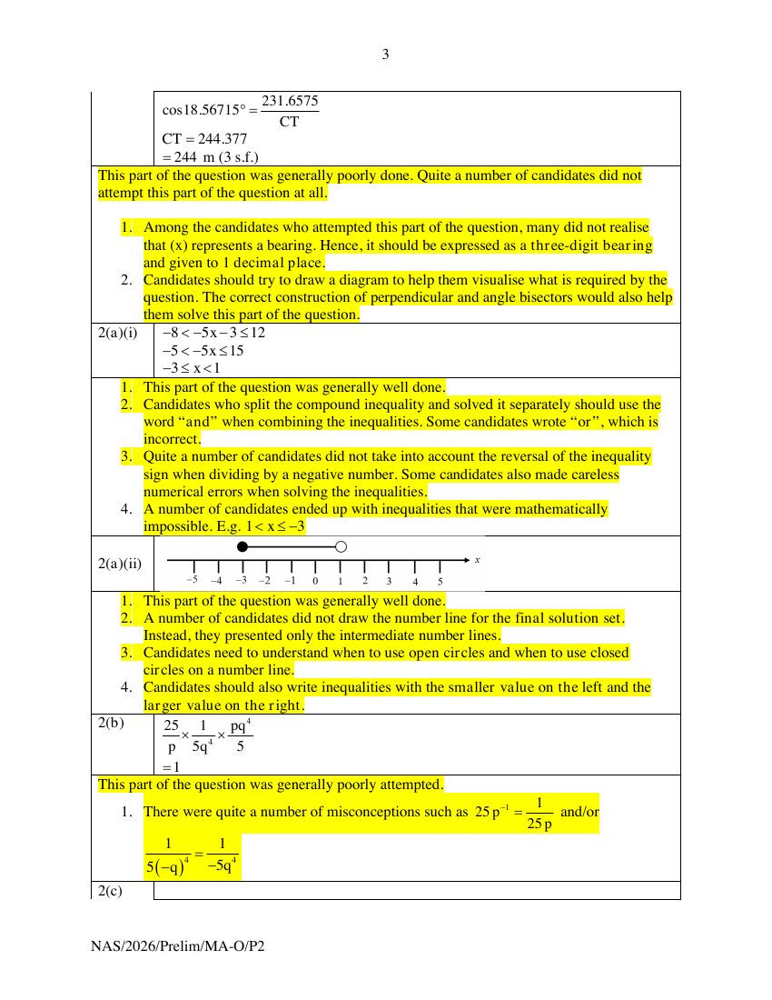
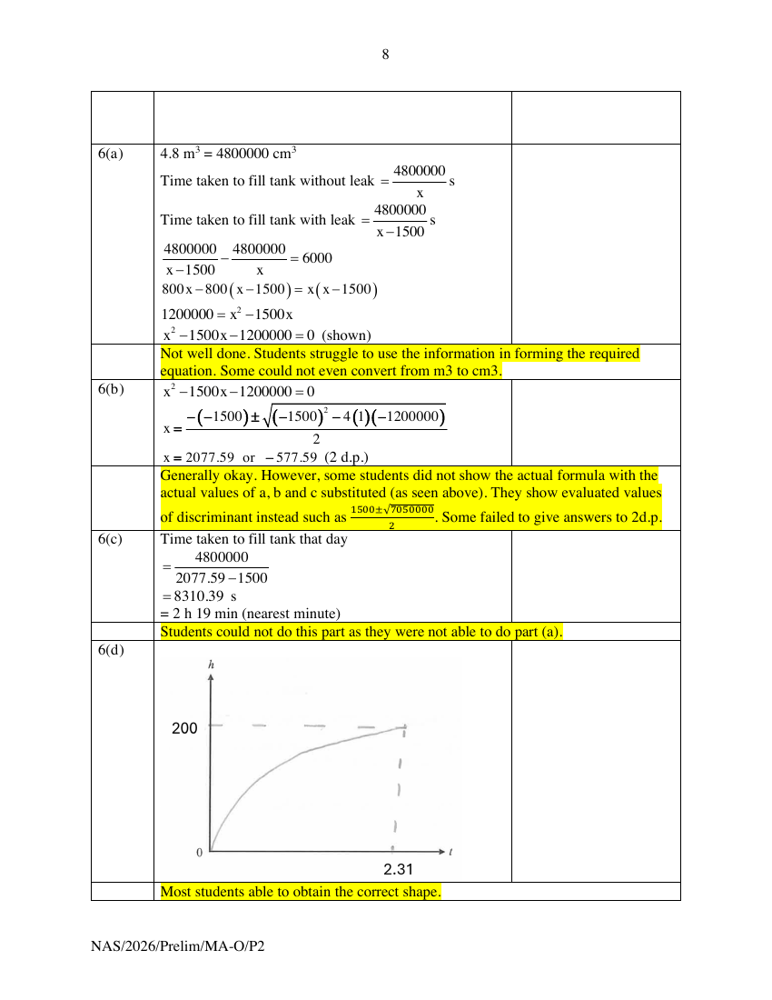

# Ngee Ann Secondary School — Mathematics Paper 2 Markers' Report (cleaned)

> **Institution:** Ngee Ann Secondary School
> **Exam:** Preliminary Examination 2026
> **Level:** Secondary 4 and 5
> **Subjects:** Mathematics
> **Paper:** Paper 2 — 4052/02 Markers' Report
> **Date:** 26 August 2026
> **Duration:** 2 hours 15 minutes
> **Total Marks:** 90
> **Source:** `NASS-2026-MA-O-S4-5-Prelim-P2-MR` (cleaned & reformatted)

---

## Answer all the questions

---

### Q1

> **Marks:** (a) [2]; (b) [2]; (c) [3]; (d) [5]; total [12]
> **Sub-topic:** Bearings, trigonometry and constructions
> **Page:** 3–5

**(a)**

$$
\begin{aligned}
\angle BAC &= 312^{\circ}-270^{\circ}=42^{\circ} \\
BC^{2} &= 418^{2}+680^{2}-2(418)(680)\cos 42^{\circ} \\
BC &= \sqrt{214661.0296} \\
&= 463.315 \\
&= 463.3\text{ m (to 1 d.p.)}
\end{aligned}
$$

> **Markers Report:** This part of the question was generally well done.
>
> 1. Candidates need to understand that, for a "show" question where the final answer is given to a required accuracy, they must show an intermediate answer to at least two more decimal places/significant figures, as appropriate, than the required accuracy. Quite a number of candidates did not do so.
> 2. Candidates need to know the importance of reading the question carefully and following the specified accuracy requirements.

**(b)** Let the drone be at point $S$.
Let the point above $C$ and at eye level of surveyor be point $E$.

$$
\begin{aligned}
\tan 16.5^{\circ} &= \frac{SE}{680} \\
SE &= 680\tan 16.5^{\circ} \\
&= 201.425\ldots \\
\text{Height of drone above }C &= 201.425+1.74 \\
&= 203.165 \\
&= 203.2\text{ m (1 d.p.)}
\end{aligned}
$$

> **Markers Report:** This part of the question was generally well done.
>
> 1. Candidates need to ensure that their presentation is clear (e.g. they should not use the letter O if it may be mistaken for the number 0).
> 2. Again, candidates should ensure that they read the question carefully, as it was specifically stated that the answer should be given to 1 decimal place.

**(c)** Locate and label $T$ by geometrical construction on the diagram: the perpendicular bisector of $BC$ and the angle bisector of angle $ACB$.

> **Markers Report:** This part of the question was generally well done.
>
> 1. Candidates who did not obtain full credit either did not attempt this part of the question or drew the perpendicular/angle bisectors inaccurately, with some construction arcs from the relevant points missing.
> 2. Candidates should also ensure that point $T$ is clearly labelled on the diagram.
> 3. A number of candidates did not fully extend the bisectors and/or used dotted lines when solid lines should have been drawn.

**(d)**

$$
\begin{aligned}
\frac{\sin\angle BCA}{418} &= \frac{\sin 42^{\circ}}{463.315} \\
\sin\angle BCA &= \frac{418\sin 42^{\circ}}{463.315} \\
\angle BCA &= \sin^{-1}\left(\frac{418\sin 42^{\circ}}{463.315}\right) \\
&= 37.1343^{\circ}
\end{aligned}
$$

Bearing of $T$ from $C$

$$
\begin{aligned}
&= 90^{\circ}-\frac{37.1343^{\circ}}{2} \\
&= 071.43284^{\circ} \\
&= 071.4^{\circ}
\end{aligned}
$$

Let the foot of perpendicular from $T$ to $BC$ be $D$.

$$
\begin{aligned}
CD &= \frac{463.315}{2}=231.6575 \\
\angle DCT &= \frac{37.1343^{\circ}}{2}=18.56715^{\circ} \\
\cos 18.56715^{\circ} &= \frac{231.6575}{CT} \\
CT &= 244.377 \\
&= 244\text{ m (3 s.f.)}
\end{aligned}
$$

$x=071.4$ and $y=244$.

> **Markers Report:** This part of the question was generally poorly done. Quite a number of candidates did not attempt this part of the question at all.
>
> 1. Among the candidates who attempted this part of the question, many did not realise that ($x$) represents a bearing. Hence, it should be expressed as a three-digit bearing and given to 1 decimal place.
> 2. Candidates should try to draw a diagram to help them visualise what is required by the question. The correct construction of perpendicular and angle bisectors would also help them solve this part of the question.

---

### Q2

> **Marks:** (a)(i) [2]; (a)(ii) [1]; (b) [2]; (c) [2]; (d) [3]; total [10]
> **Sub-topic:** Inequalities, indices and algebraic fractions
> **Page:** 6–7

**(a) (i)**

$$
\begin{aligned}
-8 &< -5x-3\leq 12 \\
-5 &< -5x\leq 15 \\
-3 &\leq x<1
\end{aligned}
$$

> **Markers Report:**
>
> 1. This part of the question was generally well done.
> 2. Candidates who split the compound inequality and solved it separately should use the word "and" when combining the inequalities. Some candidates wrote "or", which is incorrect.
> 3. Quite a number of candidates did not take into account the reversal of the inequality sign when dividing by a negative number. Some candidates also made careless numerical errors when solving the inequalities.
> 4. A number of candidates ended up with inequalities that were mathematically impossible. E.g. $1<x\leq -3$.

**(a) (ii)** Number line for $-3\leq x<1$: closed circle at $-3$, open circle at $1$.

> **Markers Report:**
>
> 1. This part of the question was generally well done.
> 2. A number of candidates did not draw the number line for the final solution set. Instead, they presented only the intermediate number lines.
> 3. Candidates need to understand when to use open circles and when to use closed circles on a number line.
> 4. Candidates should also write inequalities with the smaller value on the left and the larger value on the right.

**(b)**

$$
25p^{-1}\times\frac{1}{5(-q)^{4}}\div\frac{5}{pq^{4}}=1
$$

> **Markers Report:** This part of the question was generally poorly attempted.
>
> 1. There were quite a number of misconceptions such as $25p^{-1}=\dfrac{1}{25p}$ and/or $\dfrac{1}{5(-q)^{4}}=\dfrac{1}{-5q^{4}}$.

**(c)**

$$
\frac{7^{r+1}\left[7-6\right]}{7^{r}}=7
$$

> **Markers Report:** This part of the question was generally poorly attempted.
>
> 1. Candidates did not realise that they should first factorise out the common factor, in this case, $7^{r}$.
> 2. There were quite a number of misconceptions such as $6\left(7^{r+1}\right)=42^{r+1}$.
> 3. A number of candidates also misunderstood the question and attempted to find the value of ($r$) instead.

**(d)**

$$
\begin{aligned}
\frac{3}{2a-b}-\frac{5a+8b}{4a^{2}+4ab-3b^{2}} &= \frac{3}{2a-b}-\frac{5a+8b}{(2a-b)(2a+3b)} \\
&= \frac{3(2a+3b)-(5a+8b)}{(2a-b)(2a+3b)} \\
&= \frac{6a+9b-5a-8b}{(2a-b)(2a+3b)} \\
&= \frac{a+b}{(2a-b)(2a+3b)}
\end{aligned}
$$

> **Markers Report:** This part of the question was generally poorly attempted.
>
> 1. A majority of candidates did not realise that they should first factorise the denominator of the second fraction. Instead, they combined the two denominators immediately, resulting in unnecessarily complicated expressions in both the numerator and denominator.
> 2. A number of candidates did not use brackets when combining the numerators, which led to errors when simplifying the resulting expression.
> 3. Candidates should also leave their denominators in factorised form.

---

### Q3

> **Marks:** (a)(i) [1]; (a)(ii) [3]; (a)(iii) [2]; (b)(i) [1]; (b)(ii) [4]; total [11]
> **Sub-topic:** Graphs of functions
> **Page:** 8–9

**(a) (i)** When $x=-2$, $y=70$.

> **Markers Report:** Okay.

**(a) (ii)** Graph of $y=100-\dfrac{120}{x^{2}}$ for $-2\leq x\leq 6$.

> **Markers Report:** Most students didn't realise that this is a graph of reciprocal function and joined the points $(-1,-20)$ to $(1,-20)$. Smooth curves generally obtained. Marks were given so long points are connected to get a "smooth" curve.

**(a) (iii)** Estimated gradient

$$
=\frac{98-72}{5-0.4}=5.65\text{ (3 s.f.)}
$$

> **Markers Report:** Line of tangent is mostly drawn at the correct point. Revised range for gradient: 4.8 to 6.67. Students are advised to draw tangent better. No gap between line and curve and avoid "overlapping" with the curve (like "multiple points of intersection" to avoid).

**(b) (i)** At/After 3.5 h of charging, Power Bank A's rate of charging is 5.65% per hour.

> **Markers Report:** Okay. Stronger students understand to make reference to (iii) and is able to conclude that it is the % per hour. Weaker students were not able to connect to (i) and give answers irrelevant to the question.

**(b) (ii)**

$$
\begin{aligned}
x^{3}-5x^{2}+12 &= 0 \\
x-5+\frac{12}{x^{2}} &= 0 \\
10x-50+\frac{120}{x^{2}} &= 0 \\
10x+50 &= 100-\frac{120}{x^{2}}
\end{aligned}
$$

Draw $y=10x+50$.

Since the battery percentage after 4 h is higher with Power Bank A ($92.5\%>90\%$), Carl should charge his phone using Power Bank A.

> **Markers Report:** Poorly done, students did not know how to approach the question. They end up solving the cubic equation to obtain values of $x$.

---

### Q4

> **Marks:** (a) [2]; (b) [2]; (c) [2]; (d) [2]; total [8]
> **Sub-topic:** Vectors
> **Page:** 10–11

**(a)**

$$
\begin{aligned}
\overrightarrow{QR} &= -\frac{3}{2}\begin{pmatrix}-3\\ 1\end{pmatrix} \\
&= -\frac{3}{2}\overrightarrow{PQ}
\end{aligned}
$$

Since $\overrightarrow{QR}=-\dfrac{3}{2}\overrightarrow{PQ}$, $QR\parallel PQ$, and they have a common point $Q$, the points $P$, $Q$ and $R$ are collinear.

> **Markers Report:** Not well done. Weaker students unable to form the vector equation (did not show understanding of the meaning of the required equation). Many did not conclude that $QR\parallel PQ$ first, only state that $Q$ is the common point.

**(b)**

$$
\begin{aligned}
\overrightarrow{PQ} &= \overrightarrow{OQ}-\overrightarrow{OP} \\
\overrightarrow{OP} &= \overrightarrow{OQ}-\overrightarrow{PQ} \\
&= \begin{pmatrix}0\\ 1\end{pmatrix}-\begin{pmatrix}-3\\ 1\end{pmatrix} \\
&= \begin{pmatrix}3\\ 0\end{pmatrix}
\end{aligned}
$$

Since the $y$-coordinate of $P$ is 0, $P$ lies on the $x$-axis.

> **Markers Report:** A number of students has difficulty in finding the position vector of $P$ correctly with some who did not know how to approach the question. A small number did not conclude at all.

**(c)**

$$
\begin{aligned}
\overrightarrow{PR} &= \begin{pmatrix}-3\\ 1\end{pmatrix}-\frac{3}{2}\begin{pmatrix}-3\\ 1\end{pmatrix} \\
&= -\frac{1}{2}\begin{pmatrix}-3\\ 1\end{pmatrix} \\
&= -\frac{1}{2}\overrightarrow{PQ}
\end{aligned}
$$

So $\overrightarrow{PR}=\dfrac{1}{2}\overrightarrow{PQ}$ in magnitude, that means $\dfrac{PR}{PQ}=\dfrac{1}{2}$.

$PR:PQ=1:2$.

$n=2$.

> **Markers Report:** Poorly done. (No attempt by a number of students.) Many is not aware that the ratio can be found using the vector equation, with some of them mistakenly putting $n$ as $-2$. A number of students did not use the exact values of $PR=\sqrt{2.5}$ and $PQ=\sqrt{10}$ to find the ratio (use estimated 5 s.f. values). A number made the mistake by squaring the ratio $\sqrt{2.5}:\sqrt{10}$ instead of dividing by $\sqrt{2.5}$.

**(d)**

$$
\begin{aligned}
\frac{\text{Area of }\triangle PQS}{\text{Area of }\triangle PRS} &= \frac{PQ}{PR} \\
\frac{\text{Area of }\triangle PQS}{10} &= \frac{2}{1} \\
\text{Area of }\triangle PQS &= 20\text{ units}^{2}
\end{aligned}
$$

> **Markers Report:** Not well done, no attempt if (c) was not attempted. A few applied the reciprocal ratio instead.

---

### Q5

> **Marks:** (a)(i) [1]; (a)(ii) [1]; (a)(iii) [1]; (a)(iv) [1]; (b)(i) [2]; (b)(ii) [2]; total [8]
> **Sub-topic:** Histograms and probability
> **Page:** 12–13

**(a) (i)** The title is misleading because it interprets the data for the reader and is biased. In fact, less than 50% of the households (48%) generated less than 400 g of food waste that day.

> **Markers Report:** Only stronger students understands to state the feature (title), with some of them using headings. A number did not identify the feature and explained based on their understanding of the description from the title.

**(a) (ii)** 480 g.

> **Markers Report:** It was surprising that students forgot that the mid-value of each class interval to be used to calculate mean, they used the upper limits instead.

**(a) (iii)** 234 g (3 s.f.).

**(a) (iv)** In calculating the new estimated mean, the amount of food waste contributed by the additional household, 420 g, will be estimated to be 500 g $> 480$ g. The new estimated mean will be higher than the original one, thus the club is incorrect.

> **Markers Report:** Not many students connects the value of 420 g to be placed in the class interval (400 – 600) and the estimated value to be used is 500 g.

**(b) (i)**

$$
\frac{22}{39}\times\frac{21}{38}=\frac{77}{247}
$$

> **Markers Report:** Generally okay. Students who got this wrong probably did not read question carefully and use the wrong total. Some misunderstood and multiply the probability by 2.

**(b) (ii)**

$$
3\left(\frac{12}{29}\times\frac{17}{28}\times\frac{16}{27}\right)=\frac{272}{609}
$$

> **Markers Report:** Similarly to (b)(i), students did not use the correct total in calculation of the required probability.

---

### Q6

> **Marks:** (a) [4]; (b) [3]; (c) [2]; (d) [1]; total [10]
> **Sub-topic:** Rates, quadratic equations and graphs
> **Page:** 14–15

**(a)** $4.8\text{ m}^{3}=4800000\text{ cm}^{3}$.

Time taken to fill tank without leak $=\dfrac{4800000}{x}$ s.

Time taken to fill tank with leak $=\dfrac{4800000}{x-1500}$ s.

$$
\begin{aligned}
\frac{4800000}{x-1500}-\frac{4800000}{x} &= 6000 \\
800x-800(x-1500) &= x(x-1500) \\
1200000 &= x^{2}-1500x \\
x^{2}-1500x-1200000 &= 0\text{ (shown)}
\end{aligned}
$$

> **Markers Report:** Not well done. Students struggle to use the information in forming the required equation. Some could not even convert from m$^{3}$ to cm$^{3}$.

**(b)**

$$
\begin{aligned}
x^{2}-1500x-1200000 &= 0 \\
x &= \frac{-(-1500)\pm\sqrt{(-1500)^{2}-4(1)(-1200000)}}{2} \\
x &= 2077.59\text{ or }-577.59\text{ (2 d.p.)}
\end{aligned}
$$

> **Markers Report:** Generally okay. However, some students did not show the actual formula with the actual values of $a$, $b$ and $c$ substituted (as seen above). They show evaluated values of discriminant instead. Some failed to give answers to 2 d.p.

**(c)** Time taken to fill tank that day

$$
\begin{aligned}
&= \frac{4800000}{2077.59-1500} \\
&= 8310.39\text{ s} \\
&= 2\text{ h }19\text{ min (nearest minute)}
\end{aligned}
$$

> **Markers Report:** Students could not do this part as they were not able to do part (a).

**(d)** Sketch of $h$ against $t$.

> **Markers Report:** Most students able to obtain the correct shape.

---

### Q7

> **Marks:** (a)(i) [2]; (a)(ii) [3]; (b)(i) [1]; (b)(ii) [2]; (b)(iii) [3]; total [11]
> **Sub-topic:** Percentages and matrices
> **Page:** 16–17

**(a) (i)**

$$
\begin{aligned}
\text{Cost without set meal} &= 4.80+2.80+2.00 \\
&= &#36;9.60 \\
\text{Percentage savings} &= \frac{9.60-8.50}{9.60}\times 100\% \\
&= 11.5\%\text{ (3 s.f.)}
\end{aligned}
$$

> **Markers Report:** A very common mistake is to calculate the savings based on the set meal cost instead.

**(a) (ii)**

$$
\begin{aligned}
\left(1-\frac{x}{100}\right)(1.1)(1.09)(8.5) &= 9.7 \\
1-\frac{x}{100} &= \frac{9.7}{10.1915} \\
\frac{x}{100} &= 1-\frac{9.7}{10.1915} \\
x &= 4.8226 \\
x &= 5\text{ (nearest whole number)}
\end{aligned}
$$

> **Markers Report:** Majority of the students were not aware of how the service charge and GST is calculated. Most assumed that it is 119% of the cost of the set meal.

**(b) (i)** The elements of $P$ suggest that the cost of main dish, soup and drinks have increased by 20%, 40% and 30% respectively.

> **Markers Report:** Most students gave the answers based on the product of the two matrices and were not able to focus on the matrix $P$ which represents the percentage increase.

**(b) (ii)**

$$
\begin{pmatrix}1.2 & 1.4 & 1.3\end{pmatrix}
\begin{pmatrix}
2.20 & 1.80 \\
0.85 & 1.10 \\
0.40 & 0.40
\end{pmatrix}
=\begin{pmatrix}4.35 & 4.22\end{pmatrix}
$$

> **Markers Report:** Generally okay, with some giving the wrong order as $(2\times 1)$.

**(b) (iii)** Percentage profit

$$
\begin{aligned}
&= \frac{8.8-4.35}{4.35}\times 100\% \\
&= 102\%\text{ (3 s.f.)}
\end{aligned}
$$

Since $102\%>90\%$, the owner should not revise the selling price of the Chicken Set Meal.

> **Markers Report:** A significant number of students either misread/misunderstood the question and did not use 8.80 in their calculation. Hence, ended up calculated wrongly. A common mistake is students failed to give the comparison ($102\%>90\%$) and just mentioned that the owner should not revise the selling price.

---

### Q8

> **Marks:** (a) [2]; (b) [3]; (c)(i) [3]; (c)(ii) [1]; total [9]
> **Sub-topic:** Circle theorems and radians
> **Page:** 18–19

**(a)**

$$
\angle ABC=\angle CDE=\frac{\pi}{2}\text{ rad (right }\angle\text{ in a semicircle)}
$$

$AB\parallel DE$ because $\angle ABC$ and $\angle CDE$ are alternate angles.

> **Markers Report:** Most students failed to see that angle $ABC$ and angle $CDE$ are the 2 alternate angles. Those who struggled failed to see the use of alternate angles to prove for parallel lines. A number thought that by showing two similar triangles such $\triangle ABC$ and $\triangle EDC$, the lines $AB$ and $DE$ can be considered parallel. Some students takes the pain to show the angle $BAC$ and angle $DEC$ are equal using similar triangles proof. Answers in degrees are accepted in this case, however if student used both degree and radian together, then it would be considered wrong.

**(b)**

$$
\angle CDR=\angle PBC=0.37\text{ rad (alt. }\angle\text{s)}
$$

$$
\angle ABP=\angle EDR=\left(\frac{\pi}{2}-0.37\right)\text{ rad}
$$

$$
\angle BPC=\angle CRD=2.27\text{ rad (alt. }\angle\text{s)}
$$

$$
\angle APB=\angle ERD=(\pi-2.27)\text{ rad (adj. }\angle\text{s on a st. line)}
$$

By AA, triangle $ABP$ is similar to triangle $EDR$.

> **Markers Report:** Common mistakes from the attempted responses were not using vertices from the stated triangles. Vertices for the stated angles were not written in the corresponding order. Reason(s) were not quoted properly. No clear working to show equal pair of angles with a number of them just stated the pair of equal angles. Students were not aware that whatever they were thinking were needed to be written down as workings.
>
> For example: $\angle BPC=\angle DRC$ (alt. $\angle$) and $\angle APB=\angle ERD$ (adj $\angle$s on a str. line) which is considered unclear in this case. Students are also encouraged to state case of Similarity (AA Similarity Test) in this case.

**(c) (i)**

$$
\begin{aligned}
\angle BAC &= \pi-\angle ABP-\angle APB\quad(\angle\text{ sum of }\triangle) \\
&= \pi-\left(\frac{\pi}{2}-0.37\right)-(\pi-2.27) \\
&= 1.06920 \\
\angle BOC &= 2\times 1.06920\ldots\quad(\angle\text{ at centre }=2\angle\text{ at circumference}) \\
&= 2.1384\ldots\text{ rad} \\
&= 2.138\text{ rad (3 d.p.)}
\end{aligned}
$$

> **Markers Report:** Generally poorly attempted.
>
> 1. For students who used the correct method, a significant number of them were unaware that for such "show" questions, if the shown value is to 3 d.p., they should write down their answer to 4 d.p. as the preceding step (good practice is to give to at least 2 more d.p./s.f. than what is required, so giving answer to 5 d.p. for this question would be preferred).
> 2. Some students used isosceles triangle to find the value of angle $BOC$. This is accepted.

**(c) (ii)** Arc length

$$
\begin{aligned}
&= (8)(2.138\ldots) \\
&= 17.1\text{ cm (3 s.f.)}
\end{aligned}
$$

> **Markers Report:** Most students were able to do this question, even if they did not manage to show the value for angle $BOC$ in (i).

---

### Q9

> **Marks:** (a) [4]; (b) [7]; total [11]
> **Sub-topic:** Area scale and financial decision
> **Page:** 20–21

**(a)**

$$
\begin{aligned}
\text{Area of hall} &= (9\times 4)\times(6\times 4)=864\text{ m}^{2} \\
\text{Area of stage} &= (1.5\times 4)\times(3\times 4)=72\text{ m}^{2} \\
\text{Area of sound booth} &= (0.7\times 4)\times(2.1\times 4)=23.52\text{ m}^{2} \\
\text{Area of clear zones} &= \pi(1)^{2}\times 3.5=10.99557\text{ m}^{2} \\
\text{Total usable area} &= 864-72-23.52-10.99557=757.48443\text{ m}^{2} \\
\text{Maximum number of standing tickets} &= 757.48443\times 1.4 \\
&= 1060.478 \\
&= 1060\text{ (nearest whole number)}
\end{aligned}
$$

**(b)** Option 1:

$$
\begin{aligned}
\text{Revenue} &= 1060\times 18=&#36;19080 \\
\text{Cost} &= 1500+1060\times 1.5=&#36;3090 \\
\text{Profit} &= 19080-3090=&#36;15990
\end{aligned}
$$

Option 2:

$$
\begin{aligned}
\text{Usable area excluding safety zone} &= 757.48443-1.2\times(6\times 4) \\
&= 728.68443\text{ m}^{2} \\
\text{Usable area for Seated Zone} &= \frac{3}{5}\times 728.68443=437.21\text{ m}^{2} \\
\text{Maximum number of seated tickets} &= 437.21\times 1=437\text{ (nearest whole number)} \\
\text{Usable area for Standing Zone} &= \frac{2}{5}\times 728.68443=291.47\text{ m}^{2} \\
\text{Maximum number of standing tickets} &= 291.47\times 1.4=408.058 \\
&= 408\text{ (nearest whole number)} \\
\text{Revenue} &= 437\times 32+408\times 15=&#36;20104 \\
\text{Cost} &= 1.2\times 1500+(437+408)\times 1.5=&#36;3067.50 \\
\text{Profit} &= 20104-3067.50=&#36;17036.50
\end{aligned}
$$

Since $&#36;17036.50>&#36;15990$, Nate should select Option 2 to maximise profit and raise more funds for charity.

> **Markers Report:** For students who attempted Q9, they generally scored well. Method marks were awarded as long as attempts were taken to calculate the actual area and revenue/cost. Students who annotated and showed working clearly generally scored better, as it helped marker to award method marks.
>
> 9(a):
>
> 1. Common challenge for students were in terms of managing the differences in units (cm vs m; cm$^{2}$ vs m$^{2}$).
> 2. Some students divided the usable area by the "density", i.e. by 1.4 persons per m$^{2}$, instead of multiplying it by 1.4. For students who made this mistake, you may want to consider using units to help decide whether you should divide or multiply.
>
> 9(b):
>
> 1. Most students knew that Nate should decide by considering the profit of the respective options. A few students did not know so, and did not differentiate revenue and cost.
> 2. Amongst students who attempted, a few students did not know how to calculate the usable area for Option 2.
