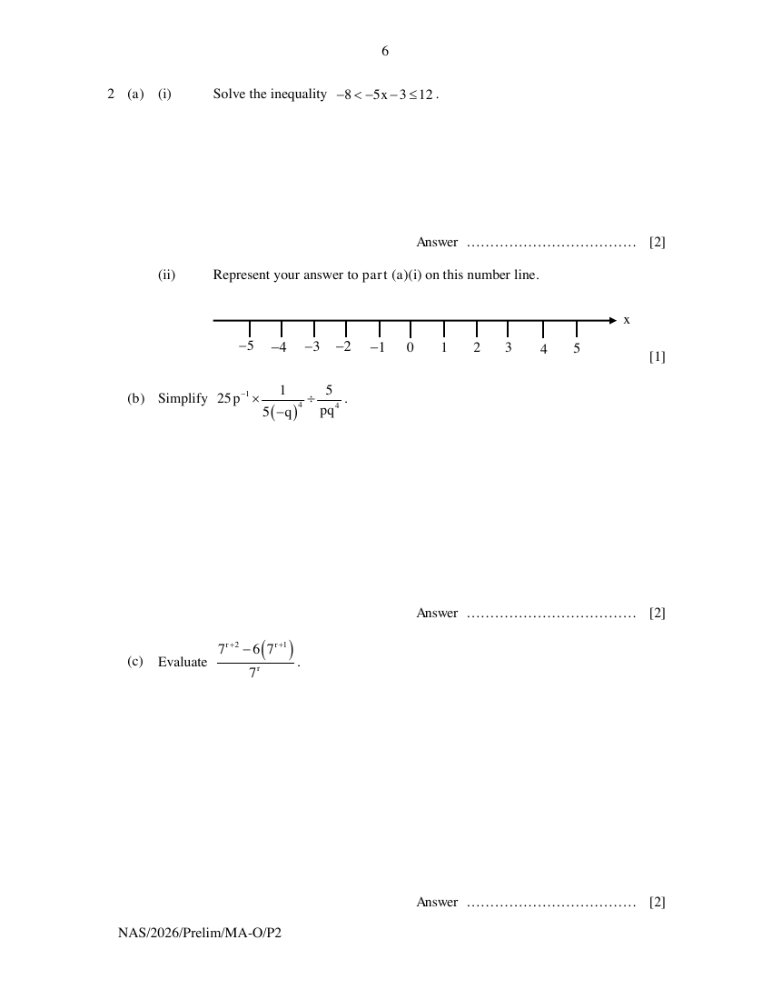
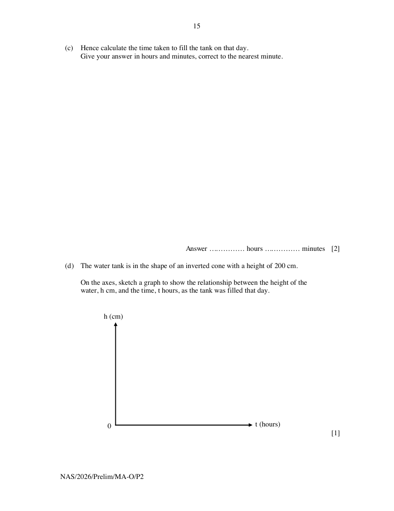
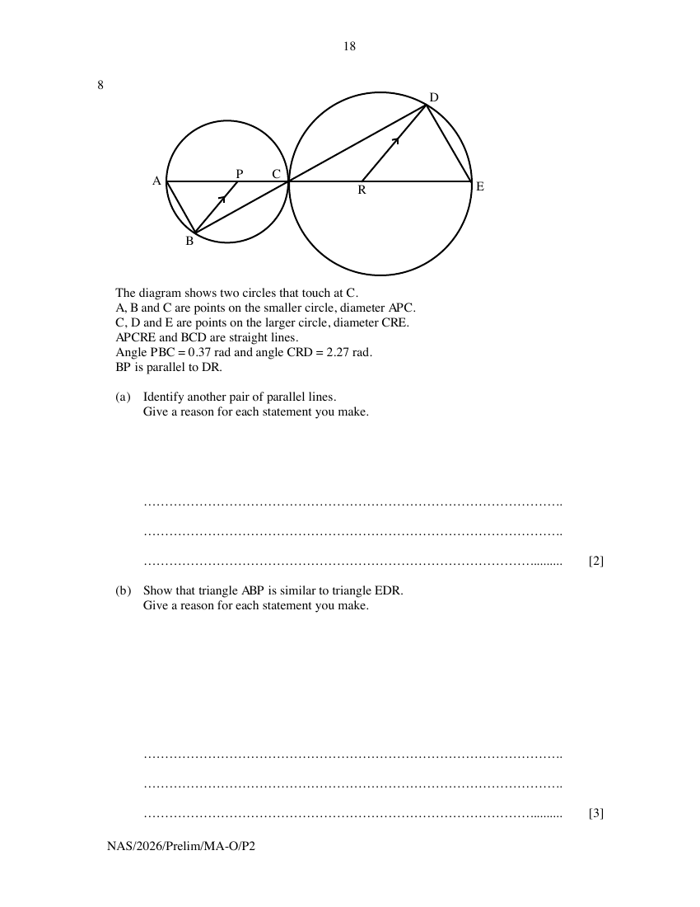

# Ngee Ann Secondary School — Mathematics 4052/02 Paper 2 (cleaned)

> **Institution:** Ngee Ann Secondary School
> **Exam:** Preliminary Examination 2026
> **Level:** Secondary 4 and 5
> **Subjects:** Mathematics
> **Paper:** 4052/02 Paper 2
> **Date:** 26 August 2026
> **Duration:** 2 hours 15 minutes
> **Total Marks:** 90
> **Source:** `NASS-2026-MA-O-S4-5-Prelim-P2-QP` (cleaned & reformatted)

---

## Instructions

Write your name, register number and class at the top of this page.
Write in dark blue or black pen.
You may use an HB pencil for any diagrams or graphs.
Do not use staples, paper clips, glue or correction fluid.

Answer all the questions.
The number of marks is given in brackets [ ] at the end of each question or part question.

If working is needed for any question it must be shown with the answer.
Omission of essential working will result in loss of marks.
The total of the marks for this paper is 90.

The use of an approved scientific calculator is expected, where appropriate.
If the degree of accuracy is not specified in the question, and if the answer is not exact, give the answer to three significant figures. Give answers in degrees to one decimal place.
For $\pi$, use either your calculator value or $3.142$.

---

## Mathematical Formulae

*Compound interest*

$$
\text{Total amount} = P\left(1+\frac{r}{100}\right)^{n}
$$

*Mensuration*

$$
\text{Curved surface area of a cone} = \pi rl
$$

$$
\text{Surface area of a sphere} = 4\pi r^{2}
$$

$$
\text{Volume of a cone} = \frac{1}{3}\pi r^{2}h
$$

$$
\text{Volume of a sphere} = \frac{4}{3}\pi r^{3}
$$

$$
\text{Area of a triangle } ABC = \frac{1}{2}ab\sin C
$$

$$
\text{Arc length} = r\theta,\text{ where }\theta\text{ is in radians}
$$

$$
\text{Sector area} = \frac{1}{2}r^{2}\theta,\text{ where }\theta\text{ is in radians}
$$

*Trigonometry*

$$
\frac{a}{\sin A} = \frac{b}{\sin B} = \frac{c}{\sin C}
$$

$$
a^{2} = b^{2}+c^{2}-2bc\cos A
$$

*Statistics*

$$
\text{Mean} = \frac{\sum fx}{\sum f}
$$

$$
\text{Standard deviation} = \sqrt{\frac{\sum fx^{2}}{\sum f}-\left(\frac{\sum fx}{\sum f}\right)^{2}}
$$

---

## Answer all the questions

---

### Q1

> **Marks:** (a) 2, (b) 2, (c) 3, (d) 5; total 12
> **Page:** 3–5

Points $A$, $B$ and $C$ are on horizontal ground.
$AB = 418\text{ m}$ and $AC = 680\text{ m}$.
$B$ is on a bearing of $312^{\circ}$ from $A$.
$C$ is due west of $A$.

**(a)** Show that $BC = 463.3\text{ m}$, correct to one decimal place. [2]
> **Topic:** G4 Pythagoras' theorem and trigonometry
> **Sub-topic:** Pythagoras' theorem and trigonometry
> **LO:** [[context/subjects/o-level-e-maths/learning-objectives/o-level-e-maths-G4g.md|G4g]]

**(b)** A surveyor is standing at point $A$ and operates a drone hovering vertically above point $C$.
The surveyor's eye level is 1.74 m above the ground.
The angle of elevation of the drone from the surveyor's eye level is $16.5^{\circ}$.

Estimate the height of the drone above the ground at point $C$.
Give your answer to one decimal place. [2]
> **Topic:** G4 Pythagoras' theorem and trigonometry
> **Sub-topic:** Pythagoras' theorem and trigonometry
> **LO:** [[context/subjects/o-level-e-maths/learning-objectives/o-level-e-maths-G4g.md|G4g]]

**(c)** The surveyor receives the following instructions.

Maintaining the same height above the ground, navigate the drone to a point $T$ within triangle $ABC$ such that $T$ is equidistant from points $B$ and $C$, and is also equidistant from the lines $AC$ and $BC$.

Using geometrical constructions, locate and label point $T$ on the diagram on the previous page. [3]
> **Topic:** G4 Pythagoras' theorem and trigonometry
> **Sub-topic:** Pythagoras' theorem and trigonometry
> **LO:** [[context/subjects/o-level-e-maths/learning-objectives/o-level-e-maths-G4g.md|G4g]]

**(d)** The surveyor receives further clarification about the location of $T$.

$T$ is on a bearing of $x^{\circ}$ from $C$.
$CT = y\text{ m}$.

By calculation, find the values of $x$ and $y$.
Do not obtain your answers by measurement from the diagram. [5]
> **Topic:** G4 Pythagoras' theorem and trigonometry
> **Sub-topic:** Pythagoras' theorem and trigonometry
> **LO:** [[context/subjects/o-level-e-maths/learning-objectives/o-level-e-maths-G4g.md|G4g]]

---

### Q2

> **Marks:** (a)(i) 2, (a)(ii) 1, (b) 2, (c) 2, (d) 3; total 10
> **Page:** 6–7

**(a) (i)** Solve the inequality $-8<-5x-3\leq 12$. [2]
> **Topic:** N7 Equations and inequalities
> **Sub-topic:** Equations and inequalities
> **LO:** [[context/subjects/o-level-e-maths/learning-objectives/o-level-e-maths-N7g.md|N7g]]

**(ii)** Represent your answer to part (a)(i) on this number line. [1]
> **Topic:** N7 Equations and inequalities
> **Sub-topic:** Equations and inequalities
> **LO:** [[context/subjects/o-level-e-maths/learning-objectives/o-level-e-maths-N7g.md|N7g]]

**(b)** Simplify $25p^{-1}\times\dfrac{1}{5(-q)^{4}}\div\dfrac{5}{pq^{4}}$. [2]
> **Topic:** N7 Equations and inequalities
> **Sub-topic:** Equations and inequalities
> **LO:** [[context/subjects/o-level-e-maths/learning-objectives/o-level-e-maths-N7g.md|N7g]]

**(c)** Evaluate $\dfrac{7^{r+2}-6\left(7^{r+1}\right)}{7^{r}}$. [2]
> **Topic:** N7 Equations and inequalities
> **Sub-topic:** Equations and inequalities
> **LO:** [[context/subjects/o-level-e-maths/learning-objectives/o-level-e-maths-N7g.md|N7g]]

**(d)** Write as a single fraction in its simplest form $\dfrac{3}{2a-b}-\dfrac{5a+8b}{4a^{2}+4ab-3b^{2}}$. [3]
> **Topic:** N7 Equations and inequalities
> **Sub-topic:** Equations and inequalities
> **LO:** [[context/subjects/o-level-e-maths/learning-objectives/o-level-e-maths-N7g.md|N7g]]

---

### Q3

> **Marks:** (a)(i) 1, (a)(ii) 3, (a)(iii) 2, (b)(i) 1, (b)(ii) 4; total 11
> **Page:** 8–9

**(a) (i)** Complete the table of values for $y=100-\dfrac{120}{x^{2}}$.

| $x$ | $-2$ | $-1$ | $1$ | $2$ | $3$ | $4$ | $5$ | $6$ |
| --- | --- | --- | --- | --- | --- | --- | --- | --- |
| $y$ |  | $-20$ | $-20$ | $70$ | $86.7$ | $92.5$ | $95.2$ | $96.7$ |

[1]
> **Topic:** G6 Coordinate geometry
> **Sub-topic:** Coordinate geometry
> **LO:** [[context/subjects/o-level-e-maths/learning-objectives/o-level-e-maths-G6c.md|G6c]]

**(ii)** On the grid, draw the graph of $y=100-\dfrac{120}{x^{2}}$ for $-2\leq x\leq 6$. [3]
> **Topic:** G6 Coordinate geometry
> **Sub-topic:** Coordinate geometry
> **LO:** [[context/subjects/o-level-e-maths/learning-objectives/o-level-e-maths-G6c.md|G6c]]

**(iii)** By drawing a tangent, estimate the gradient of the curve at $x=3.5$. [2]
> **Topic:** G6 Coordinate geometry
> **Sub-topic:** Coordinate geometry
> **LO:** [[context/subjects/o-level-e-maths/learning-objectives/o-level-e-maths-G6c.md|G6c]]

**(b)** Carl has two types of power banks, Power Bank A and Power Bank B, for charging his mobile phone.

**(i)** Using Power Bank A, the battery percentage, $y\%$, of Carl's mobile phone after $x$ hours of charging is given by the function $y=100-\dfrac{120}{x^{2}}$, $x\geq 2$.

What does your answer to part (a)(iii) tell you about Power Bank A? [1]
> **Topic:** G6 Coordinate geometry
> **Sub-topic:** Coordinate geometry
> **LO:** [[context/subjects/o-level-e-maths/learning-objectives/o-level-e-maths-G6c.md|G6c]]

**(ii)** The solutions to the equation $x^{3}-5x^{2}+12=0$ represent the charging durations for which Power Bank A and Power Bank B charge Carl's phone to the same battery percentage.
Carl has only 4 hours to charge his mobile phone.

By drawing a suitable straight line on the grid, determine whether Carl should use Power Bank A or Power Bank B. [4]
> **Topic:** G6 Coordinate geometry
> **Sub-topic:** Coordinate geometry
> **LO:** [[context/subjects/o-level-e-maths/learning-objectives/o-level-e-maths-G6c.md|G6c]]

---

### Q4

> **Marks:** (a) 2, (b) 2, (c) 2, (d) 2; total 8
> **Page:** 10–11

**(a)** $\overrightarrow{PQ}=\begin{pmatrix}-3\\ 1\end{pmatrix}$ and $\overrightarrow{QR}=\dfrac{1}{2}\begin{pmatrix}9\\ -3\end{pmatrix}$.

Explain why the points $P$, $Q$ and $R$ are collinear. [2]
> **Topic:** G7 Vectors in two dimensions
> **Sub-topic:** Vectors in two dimensions
> **LO:** [[context/subjects/o-level-e-maths/learning-objectives/o-level-e-maths-G7h.md|G7h]]

**(b)** The coordinates of $Q$ are $(0, 1)$.

Show that $P$ lies on the $x$-axis. [2]
> **Topic:** G7 Vectors in two dimensions
> **Sub-topic:** Vectors in two dimensions
> **LO:** [[context/subjects/o-level-e-maths/learning-objectives/o-level-e-maths-G7h.md|G7h]]

**(c)** The lengths of $PR$ and $PQ$ are in the ratio $1:n$.

Find the value of $n$. [2]
> **Topic:** G7 Vectors in two dimensions
> **Sub-topic:** Vectors in two dimensions
> **LO:** [[context/subjects/o-level-e-maths/learning-objectives/o-level-e-maths-G7h.md|G7h]]

**(d)** A point, $S$, is positioned such that the area of triangle $PRS$ is $10\text{ units}^{2}$.

Find the area of triangle $PQS$. [2]
> **Topic:** G7 Vectors in two dimensions
> **Sub-topic:** Vectors in two dimensions
> **LO:** [[context/subjects/o-level-e-maths/learning-objectives/o-level-e-maths-G7h.md|G7h]]

---

### Q5

> **Marks:** (a)(i) 1, (a)(ii) 1, (a)(iii) 1, (a)(iv) 1, (b)(i) 2, (b)(ii) 2; total 8
> **Page:** 12–13

A sustainability club measures the amount of food waste generated on a particular day by 100 households.

**(a)** The histogram shows the distribution of food waste generated by the households.

**(i)** State one misleading feature of the histogram and explain how it could affect the reader's interpretation of the data. [1]
> **Topic:** S2 Probability
> **Sub-topic:** Probability
> **LO:** [[context/subjects/o-level-e-maths/learning-objectives/o-level-e-maths-S2a.md|S2a]]

**(ii)** Calculate an estimate of the mean mass. [1]
> **Topic:** S2 Probability
> **Sub-topic:** Probability
> **LO:** [[context/subjects/o-level-e-maths/learning-objectives/o-level-e-maths-S2a.md|S2a]]

**(iii)** Calculate an estimate of the standard deviation of the masses. [1]
> **Topic:** S2 Probability
> **Sub-topic:** Probability
> **LO:** [[context/subjects/o-level-e-maths/learning-objectives/o-level-e-maths-S2a.md|S2a]]

**(iv)** The club forgot to include the food waste generated by one household.
The household generated 420 g of food waste that day.
The club updates the histogram to include this household and recalculates the estimated mean using the grouped data.
The club expects the estimated mean to decrease.

Without calculation, explain whether the club is correct. [1]
> **Topic:** S2 Probability
> **Sub-topic:** Probability
> **LO:** [[context/subjects/o-level-e-maths/learning-objectives/o-level-e-maths-S2a.md|S2a]]

**(b)** The club also surveys 80 households from two residential blocks, Block A and Block B.
Each household is classified according to the main type of food waste it threw away.
The frequency table summarises the data collected.

|  | Block A | Block B |
| --- | --- | --- |
| Cooked Food | 22 | 29 |
| Uncooked Scraps | 17 | 12 |

**(i)** Two households in Block A are chosen at random.

Find the probability that both households threw away cooked food. [2]
> **Topic:** S2 Probability
> **Sub-topic:** Probability
> **LO:** [[context/subjects/o-level-e-maths/learning-objectives/o-level-e-maths-S2c.md|S2c]]

**(ii)** Three households that threw away uncooked scraps are chosen at random.

Find the probability that exactly one of the households is from Block B. [2]
> **Topic:** S2 Probability
> **Sub-topic:** Probability
> **LO:** [[context/subjects/o-level-e-maths/learning-objectives/o-level-e-maths-S2c.md|S2c]]

---

### Q6

> **Marks:** (a) 4, (b) 3, (c) 2, (d) 1; total 10
> **Page:** 14–15

An empty water tank has a capacity of $4.8\text{ m}^{3}$.
An inlet pipe pumps water into the tank at a constant rate of $x\text{ cm}^{3}/\text{s}$.
On a particular day, the tank took 1 hour 40 minutes longer than usual to fill because of a crack at the bottom of the tank.
Water leaked through the crack at a constant rate of $1500\text{ cm}^{3}/\text{s}$.

**(a)** Show that $x^{2}-1500x-1200000=0$. [4]
> **Topic:** N6 Functions and graphs
> **Sub-topic:** Functions and graphs
> **LO:** [[context/subjects/o-level-e-maths/learning-objectives/o-level-e-maths-N6c.md|N6c]]

**(b)** Solve the equation $x^{2}-1500x-1200000=0$.
Give your solutions correct to two decimal places. [3]
> **Topic:** N6 Functions and graphs
> **Sub-topic:** Functions and graphs
> **LO:** [[context/subjects/o-level-e-maths/learning-objectives/o-level-e-maths-N6c.md|N6c]]

**(c)** Hence calculate the time taken to fill the tank on that day.
Give your answer in hours and minutes, correct to the nearest minute. [2]
> **Topic:** N6 Functions and graphs
> **Sub-topic:** Functions and graphs
> **LO:** [[context/subjects/o-level-e-maths/learning-objectives/o-level-e-maths-N6c.md|N6c]]

**(d)** The water tank is in the shape of an inverted cone with a height of 200 cm.

On the axes, sketch a graph to show the relationship between the height of the water, $h$ cm, and the time, $t$ hours, as the tank was filled that day. [1]
> **Topic:** N6 Functions and graphs
> **Sub-topic:** Functions and graphs
> **LO:** [[context/subjects/o-level-e-maths/learning-objectives/o-level-e-maths-N6c.md|N6c]]

---

### Q7

> **Marks:** (a)(i) 2, (a)(ii) 3, (b)(i) 1, (b)(ii) 2, (b)(iii) 3; total 11
> **Page:** 16–17

A café offers the following menu.

| Main Dish | Price | Drink | Price |
| --- | --- | --- | --- |
| Chicken Burger | &#36;5.80 | Apple Juice | &#36;2.00 |
| Vegan Burger | &#36;4.80 | Orange Juice | &#36;2.00 |

| Soup | Price |
| --- | --- |
| Chicken Soup | &#36;2.20 |
| Mushroom Soup | &#36;2.80 |
| Onion Soup | &#36;3.00 |

| Set Meal | Price |
| --- | --- |
| Chicken Set Meal (Chicken Burger + Chicken Soup + a drink) | &#36;8.80 |
| Vegan Set Meal (Vegan Burger + Mushroom Soup + a drink) | &#36;8.50 |

**(a)** A customer orders the vegan set meal.

**(i)** Find the percentage saving when the customer orders the set meal instead of ordering the items separately. [2]
> **Topic:** N3 Percentage
> **Sub-topic:** Percentage
> **LO:** [[context/subjects/o-level-e-maths/learning-objectives/o-level-e-maths-N3d.md|N3d]]

**(ii)** The customer receives an $x\%$ discount as a member of the café's loyalty programme.
The total bill, inclusive of a 10% service charge and 9% Goods and Services Tax (GST), is &#36;9.70.

Find $x$.
Give your answer to the nearest whole number. [3]
> **Topic:** N3 Percentage
> **Sub-topic:** Percentage
> **LO:** [[context/subjects/o-level-e-maths/learning-objectives/o-level-e-maths-N3d.md|N3d]]

**(b)** Every month, the café owner reviews the cost and selling prices of the set meals.

The owner uses a $1\times 2$ matrix $D$ to represent the new cost prices of the two set meals.
$D=PC$, where

$$
P=\begin{pmatrix}1.2 & 1.4 & 1.3\end{pmatrix}
\quad\text{and}\quad
C=\begin{pmatrix}
2.20 & 1.80 \\
0.85 & 1.10 \\
0.40 & 0.40
\end{pmatrix}
$$

The columns of $C$ are Chicken and Vegan. The rows of $C$ are Main Dish, Soup and Drinks.

$C$ represents the original cost prices of the main dish, soup and drink for each set meal.

**(i)** State what the elements of $P$ represent. [1]
> **Topic:** N3 Percentage
> **Sub-topic:** Percentage
> **LO:** [[context/subjects/o-level-e-maths/learning-objectives/o-level-e-maths-N3d.md|N3d]]

**(ii)** Evaluate the matrix $D$. [2]
> **Topic:** N3 Percentage
> **Sub-topic:** Percentage
> **LO:** [[context/subjects/o-level-e-maths/learning-objectives/o-level-e-maths-N3d.md|N3d]]

**(iii)** The owner revises the selling price if the percentage profit from selling a set meal is less than 90%.

Determine whether the owner should revise the selling price of the Chicken Set Meal.
Justify your answer with working. [3]
> **Topic:** N3 Percentage
> **Sub-topic:** Percentage
> **LO:** [[context/subjects/o-level-e-maths/learning-objectives/o-level-e-maths-N3d.md|N3d]]

---

### Q8

> **Marks:** (a) 2, (b) 3, (c)(i) 3, (c)(ii) 1; total 9
> **Page:** 18–19

The diagram shows two circles that touch at $C$.
$A$, $B$ and $C$ are points on the smaller circle, diameter $APC$.
$C$, $D$ and $E$ are points on the larger circle, diameter $CRE$.
$APCRE$ and $BCD$ are straight lines.
Angle $PBC = 0.37\text{ rad}$ and angle $CRD = 2.27\text{ rad}$.
$BP$ is parallel to $DR$.

**(a)** Identify another pair of parallel lines.
Give a reason for each statement you make. [2]
> **Topic:** G5 Mensuration
> **Sub-topic:** Mensuration
> **LO:** [[context/subjects/o-level-e-maths/learning-objectives/o-level-e-maths-G5f.md|G5f]]

**(b)** Show that triangle $ABP$ is similar to triangle $EDR$.
Give a reason for each statement you make. [3]
> **Topic:** G5 Mensuration
> **Sub-topic:** Mensuration
> **LO:** [[context/subjects/o-level-e-maths/learning-objectives/o-level-e-maths-G5f.md|G5f]]

**(c)** Let $O$ be the centre of the smaller circle.
The radius of the smaller circle is 8 cm.

**(i)** Show that angle $BOC = 2.138\text{ rad}$, correct to three decimal places. [3]
> **Topic:** G5 Mensuration
> **Sub-topic:** Mensuration
> **LO:** [[context/subjects/o-level-e-maths/learning-objectives/o-level-e-maths-G5f.md|G5f]]

**(ii)** Hence calculate the length of the minor arc $BC$. [1]
> **Topic:** G5 Mensuration
> **Sub-topic:** Mensuration
> **LO:** [[context/subjects/o-level-e-maths/learning-objectives/o-level-e-maths-G5f.md|G5f]]

---

### Q9

> **Marks:** (a) 4, (b) 7; total 11
> **Page:** 20–21

Nate plans a charity concert in the school hall.
The school provides him with the following information to determine the maximum number of concert tickets that can be sold.

Safety directives

- To ensure safe emergency evacuation, there must be a semicircular clear zone with a radius of 1 m in front of each exit.
- The usable area excludes the stage, the sound booth and the clear zones.
- Standing Zone: maximum crowd density is 1.4 persons per m$^{2}$ of usable area.
- Seated Zone: maximum crowd density is 1.0 persons per m$^{2}$ of usable area.

Floor plan of the hall drawn accurately to a scale of $1:400$

**(a)** Find the maximum number of standing concert tickets that can be sold.
Give your answer correct to the nearest whole number. [4]
> **Topic:** G5 Mensuration
> **Sub-topic:** Mensuration
> **LO:** [[context/subjects/o-level-e-maths/learning-objectives/o-level-e-maths-G5b.md|G5b]]

Nate considers two ticketing options and their associated logistical costs.

Ticketing Option 1: Pure Standing Setup

- Standing tickets: &#36;18 per ticket

Ticketing Option 2: Hybrid Setup (Seated + Standing)

- The usable area is divided into three distinct zones: the Seated Zone that is nearest the stage, followed by the Safety Zone, then the Standing Zone.
- The Safety Zone is a horizontal strip, 1.2 m wide, separating the Seated Zone from the Standing Zone.
- After excluding the Safety Zone, the remaining usable area is divided in the ratio $3:2$ between the Seated Zone and the Standing Zone respectively.
- Seated tickets: &#36;32 per ticket
- Standing ticket: &#36;15 per ticket

Logistical Costs

- Fixed setup cost: The logistics team charges a fixed fee of &#36;1500 for Option 1. This fee is 20% higher for Option 2 due to the additional logistics required for chair installation.
- Transaction fee: A fee of &#36;1.50 is charged by the online ticketing vendor for every ticket sold.

**(b)** Determine the option that Nate should select.
Justify the decision you make and show your calculations clearly. [7]
> **Topic:** G5 Mensuration
> **Sub-topic:** Mensuration
> **LO:** [[context/subjects/o-level-e-maths/learning-objectives/o-level-e-maths-G5b.md|G5b]]

---

**END OF PAPER**
