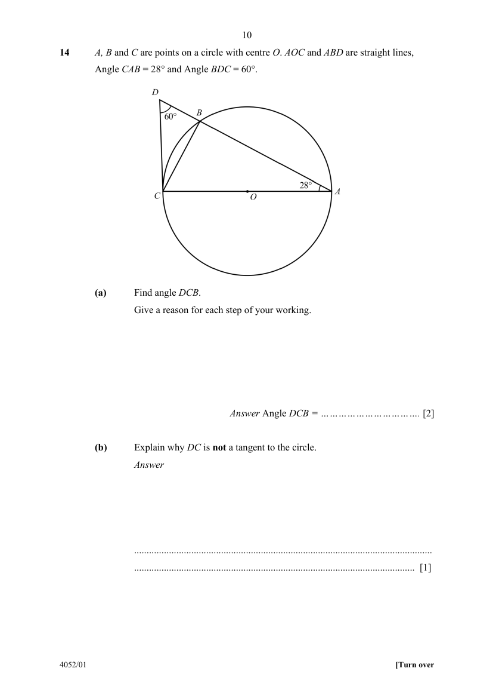
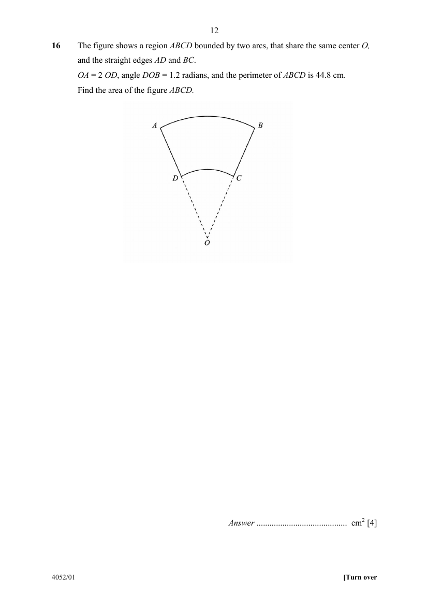
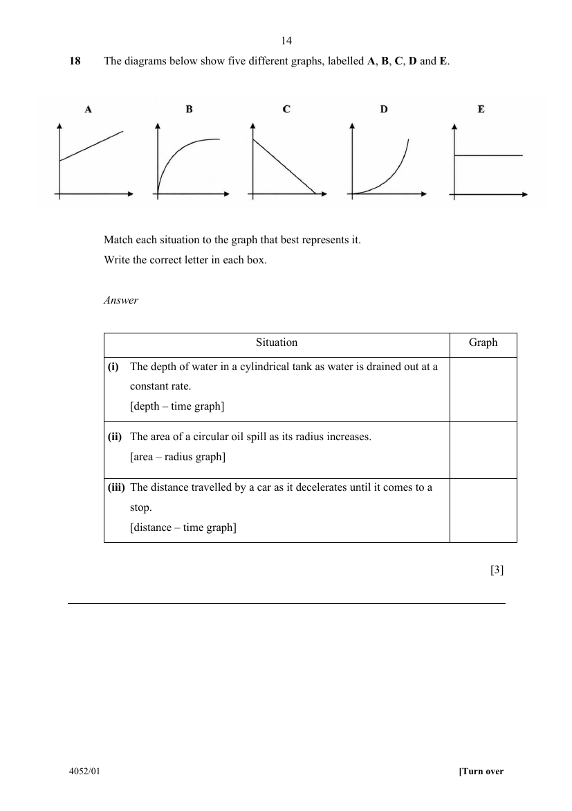
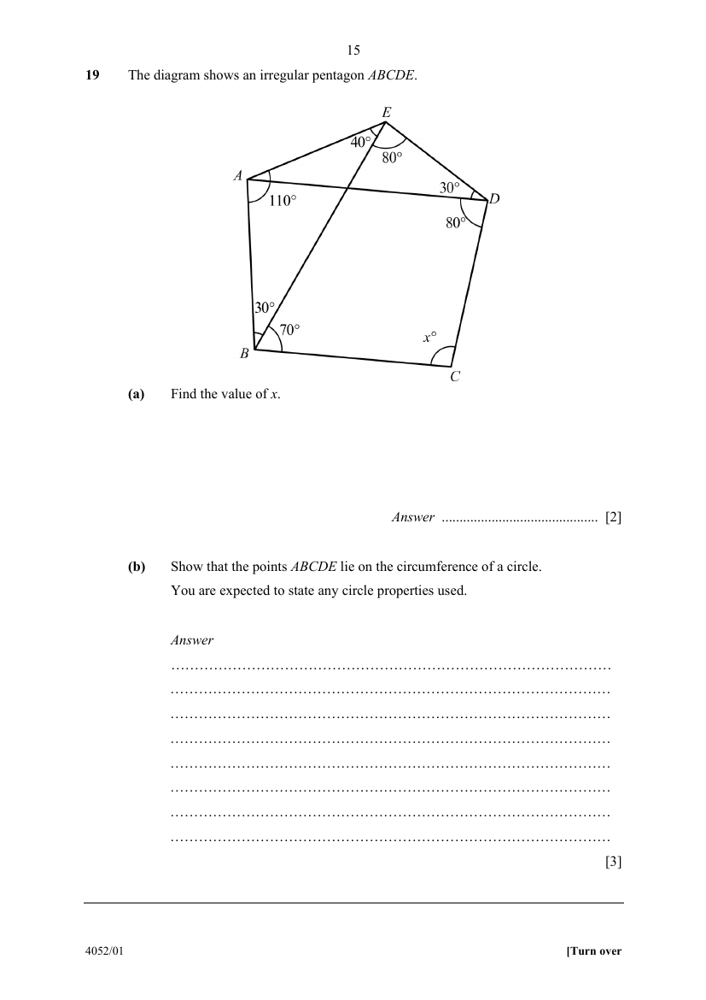
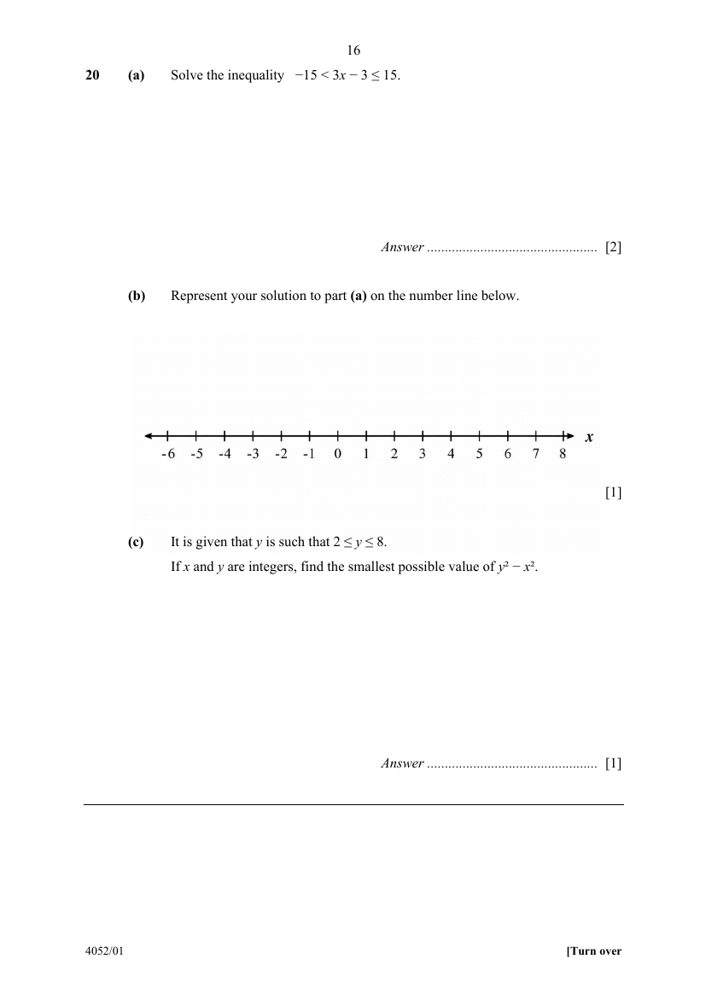

# St. Patrick's School — Mathematics 4052/01 Paper 1 (cleaned)

> **Institution:** St. Patrick's School
> **Exam:** Preliminary Examination 2026
> **Level:** Secondary 4EXP/5NA
> **Subjects:** Mathematics
> **Paper:** 4052/01 Paper 1
> **Date:** 17 August 2026
> **Duration:** 2 hours 15 minutes
> **Total Marks:** 90
> **Source:** `SPS-EM-2026-4G3-P1-Final` (cleaned & reformatted)

---

## Instructions

Write your Name, Form Class and Acad Class in the spaces at the top of the page.
Write in dark blue or black pen.
You may use an HB pencil for any diagrams or graphs.
Do not use staples, paper clips, glue or correction fluid.

Answer all questions.
The number of marks is given in brackets [ ] at the end of each question or part question.

If working is needed for any question it must be shown with the answer.
Omission of essential working will result in loss of marks.
The total of the marks for this paper is 90.

The use of an approved scientific calculator is expected, where appropriate.
If the degree of accuracy is not specified in the question and if the answer is not exact, give the answer to three significant figures. Give answers in degrees to one decimal place.
For $\pi$, use either your calculator value or $3.142$.

---

## Mathematical Formulae

*Compound interest*

$$
\text{Total amount} = P\left(1+\frac{r}{100}\right)^{n}
$$

*Mensuration*

$$
\text{Curved surface area of a cone} = \pi rl
$$

$$
\text{Surface area of a sphere} = 4\pi r^{2}
$$

$$
\text{Volume of a cone} = \frac{1}{3}\pi r^{2}h
$$

$$
\text{Volume of a sphere} = \frac{4}{3}\pi r^{3}
$$

$$
\text{Area of triangle } ABC = \frac{1}{2}ab\sin C
$$

$$
\text{Arc length} = r\theta,\text{ where }\theta\text{ is in radians}
$$

$$
\text{Sector area} = \frac{1}{2}r^{2}\theta,\text{ where }\theta\text{ is in radians}
$$

*Trigonometry*

$$
\frac{a}{\sin A} = \frac{b}{\sin B} = \frac{c}{\sin C}
$$

$$
a^{2} = b^{2}+c^{2}-2bc\cos A
$$

*Statistics*

$$
\text{Mean} = \frac{\sum fx}{\sum f}
$$

$$
\text{Standard deviation} = \sqrt{\frac{\sum fx^{2}}{\sum f}-\left(\frac{\sum fx}{\sum f}\right)^{2}}
$$

---

## Answer all the questions

---

### Q1

> **Marks:** 1
> **Topic:** N2 Ratio and proportion
> **Sub-topic:** Ratio and proportion
> **LO:** [[context/subjects/o-level-e-maths/learning-objectives/o-level-e-maths-N2a.md|N2a]]
> **Page:** 3

Calculate $\sqrt[3]{15.6^{2}-\dfrac{9.4}{0.028}}$. [1]

---

### Q2

> **Marks:** (a) 1, (b) 1; total 2
> **Page:** 3

Simplify.

**(a)** $2p^{4}\times 6p^{-5}$ [1]
> **Topic:** N5 Algebraic expressions and formulae
> **Sub-topic:** Algebraic expressions and formulae
> **LO:** [[context/subjects/o-level-e-maths/learning-objectives/o-level-e-maths-N5b.md|N5b]]

**(b)** $4(3x-2)-5$ [1]
> **Topic:** N5 Algebraic expressions and formulae
> **Sub-topic:** Algebraic expressions and formulae
> **LO:** [[context/subjects/o-level-e-maths/learning-objectives/o-level-e-maths-N5b.md|N5b]]

---

### Q3

> **Marks:** (a) 1, (b) 1; total 2
> **Page:** 3

**(a)** Express $0.00047$ in standard form. [1]
> **Topic:** N1 Numbers and their operations
> **Sub-topic:** Numbers and their operations
> **LO:** [[context/subjects/o-level-e-maths/learning-objectives/o-level-e-maths-N1h.md|N1h]]

**(b)** Express $1\text{ km}$ as a percentage of $0.4\text{ nm}$, where $1\text{ nm}=1\times 10^{-9}\text{ m}$.
Give your answer in standard form. [1]
> **Topic:** N1 Numbers and their operations
> **Sub-topic:** Numbers and their operations
> **LO:** [[context/subjects/o-level-e-maths/learning-objectives/o-level-e-maths-N1h.md|N1h]]

---

### Q4

> **Marks:** 2
> **Topic:** N2 Ratio and proportion
> **Sub-topic:** Ratio and proportion
> **LO:** [[context/subjects/o-level-e-maths/learning-objectives/o-level-e-maths-N2a.md|N2a]]
> **Page:** 4

The magnetic force, $F$, between two magnets is inversely proportional to the square of the distance, $d$, between them.
At a certain distance the force is $0.8\text{ N}$.
Find the increase in the magnetic force when the distance is halved. [2]

---

### Q5

> **Marks:** 3
> **Topic:** N7 Equations and inequalities
> **Sub-topic:** Equations and inequalities
> **LO:** [[context/subjects/o-level-e-maths/learning-objectives/o-level-e-maths-N7c.md|N7c]]
> **Page:** 4

A bag of sand has a mass of $x\text{ kg}$ and a bag of cement has a mass of $y\text{ kg}$.
Two bags of sand have a mass that is $10\text{ kg}$ more than one bag of cement.
A delivery of $4$ bags of sand and $3$ bags of cement has a total mass of $220\text{ kg}$.
Find the value of $x$ and $y$. [3]

---

### Q6

> **Marks:** 3
> **Topic:** N1 Numbers and their operations
> **Sub-topic:** Numbers and their operations
> **LO:** [[context/subjects/o-level-e-maths/learning-objectives/o-level-e-maths-N1e.md|N1e]]
> **Page:** 5

A toy building block is a cuboid measuring $24\text{ mm}$ by $16\text{ mm}$ by $10\text{ mm}$.
Identical blocks are stacked together to form a cube.
Find the length of the smallest possible cube that can be formed, and the number of blocks needed. [3]

---

### Q7

> **Marks:** 3
> **Topic:** N2 Ratio and proportion
> **Sub-topic:** Ratio and proportion
> **LO:** [[context/subjects/o-level-e-maths/learning-objectives/o-level-e-maths-N2a.md|N2a]]
> **Page:** 5

In Class A, the ratio of boys to girls is $5:2$.
In Class B, the ratio of boys to girls is $7:4$.
The two classes have the same number of boys.
Express as a fraction, the total number of girls in both classes. [3]

---

### Q8

> **Marks:** 3
> **Topic:** N1 Numbers and their operations
> **Sub-topic:** Numbers and their operations
> **LO:** [[context/subjects/o-level-e-maths/learning-objectives/o-level-e-maths-N1g.md|N1g]]
> **Page:** 6

Solve the equation $3x^{2}-7x+1=0$, giving your answers correct to $2$ decimal places. [3]

---

### Q9

> **Marks:** 3
> **Topic:** G2 Congruence and similarity
> **Sub-topic:** Congruence and similarity
> **LO:** [[context/subjects/o-level-e-maths/learning-objectives/o-level-e-maths-G2i.md|G2i]]
> **Page:** 6

In the diagram, $AC$ and $BD$ intersect at $M$.
$M$ is the midpoint of both $AC$ and $BD$.
Show that $AB$ is parallel to $CD$. [3]

---

### Q10

> **Marks:** (a)(i) 1, (a)(ii) 1, (b) 2; total 4
> **Page:** 7

The table shows the times, $t$ minutes, taken by $40$ students to complete a Mathematics quiz.

| Time, $t$ (minutes) | Frequency |
| --- | --- |
| $30\leq t<40$ | $6$ |
| $40\leq t<50$ | $10$ |
| $50\leq t<60$ | $16$ |
| $60\leq t<70$ | $8$ |

**(a)** Calculate an estimate for

**(i)** the mean time, [1]
> **Topic:** S1 Data handling and analysis
> **Sub-topic:** Data handling and analysis
> **LO:** [[context/subjects/o-level-e-maths/learning-objectives/o-level-e-maths-S1f.md|S1f]]

**(ii)** the standard deviation of the times. [1]
> **Topic:** S1 Data handling and analysis
> **Sub-topic:** Data handling and analysis
> **LO:** [[context/subjects/o-level-e-maths/learning-objectives/o-level-e-maths-S1f.md|S1f]]

**(b)** Each recorded time was $5$ minutes less than the actual time, so $5$ minutes is added to each time to correct it.

Explain how the mean and standard deviation of the corrected times compare with the values in (a). [2]
> **Topic:** S1 Data handling and analysis
> **Sub-topic:** Data handling and analysis
> **LO:** [[context/subjects/o-level-e-maths/learning-objectives/o-level-e-maths-S1f.md|S1f]]

---

### Q11

> **Marks:** (a) 1, (b) 2; total 3
> **Page:** 7

Two fair four-sided dice, each with faces numbered $1$, $2$, $3$ and $4$, are thrown. The two numbers shown are multiplied to give the score.
In a game, Aisha wins if the score is even and Ben wins if the score is odd.

**(a)** Explain why the game is unfair. [1]
> **Topic:** S2 Probability
> **Sub-topic:** Probability
> **LO:** [[context/subjects/o-level-e-maths/learning-objectives/o-level-e-maths-S2c.md|S2c]]

**(b)** Aisha claims that she is twice as likely to win as Ben. Determine whether Aisha is correct. [2]
> **Topic:** S2 Probability
> **Sub-topic:** Probability
> **LO:** [[context/subjects/o-level-e-maths/learning-objectives/o-level-e-maths-S2c.md|S2c]]

---

### Q12

> **Marks:** 3
> **Topic:** G4 Pythagoras' theorem and trigonometry
> **Sub-topic:** Pythagoras' theorem and trigonometry
> **LO:** [[context/subjects/o-level-e-maths/learning-objectives/o-level-e-maths-G4e.md|G4e]]
> **Page:** 8

The area of triangle $PQR$ is $67.67\text{ cm}^{2}$. Given that $QP=9.8\text{ cm}$ and $QR=15\text{ cm}$, find the possible values of angle $PQR$. [3]

---

### Q13

> **Marks:** 3
> **Topic:** G5 Mensuration
> **Sub-topic:** Mensuration
> **LO:** [[context/subjects/o-level-e-maths/learning-objectives/o-level-e-maths-G5c.md|G5c]]
> **Page:** 9

A closed cylinder fits two identical spheres exactly, as shown. Each sphere touches the curved surface of the cylinder, and the spheres touch each other and the two flat ends.

Find the fraction of the volume of the cylinder that is **not** occupied by the spheres, giving your answer in its simplest form. [3]

---

### Q14

> **Marks:** (a) 2, (b) 1; total 3
> **Page:** 10

$A$, $B$ and $C$ are points on a circle with centre $O$. $AOC$ and $ABD$ are straight lines,
Angle $CAB=28^{\circ}$ and Angle $BDC=60^{\circ}$.

**(a)** Find angle $DCB$.
Give a reason for each step of your working. [2]
> **Topic:** G3 Properties of circles
> **Sub-topic:** Properties of circles
> **LO:** [[context/subjects/o-level-e-maths/learning-objectives/o-level-e-maths-G3b.md|G3b]]

**(b)** Explain why $DC$ is **not** a tangent to the circle. [1]
> **Topic:** G3 Properties of circles
> **Sub-topic:** Properties of circles
> **LO:** [[context/subjects/o-level-e-maths/learning-objectives/o-level-e-maths-G3b.md|G3b]]

---

### Q15

> **Marks:** (a) 1, (b) 1, (c) 2; total 4
> **Page:** 11

The diagram shows the first three figures in a sequence. Each figure is a large square made up of unit squares, with a shaded square block at its centre.

| Figure number, $n$ | $1$ | $2$ | $3$ | $4$ |
| --- | --- | --- | --- | --- |
| Number of shaded squares | $1$ | $4$ | $9$ |  |
| Number of unshaded squares | $8$ | $12$ | $16$ |  |

**(a)** Complete the table for Figure $4$. [1]
> **Topic:** N1 Numbers and their operations
> **Sub-topic:** Numbers and their operations
> **LO:** [[context/subjects/o-level-e-maths/learning-objectives/o-level-e-maths-N1b.md|N1b]]

**(b)** Write down an expression, in terms of $n$, for the number of unshaded squares in Figure $n$. [1]
> **Topic:** N1 Numbers and their operations
> **Sub-topic:** Numbers and their operations
> **LO:** [[context/subjects/o-level-e-maths/learning-objectives/o-level-e-maths-N1b.md|N1b]]

**(c)** One figure in the sequence has $96$ unshaded squares.
Find the number of **shaded** squares in this figure. [2]
> **Topic:** N1 Numbers and their operations
> **Sub-topic:** Numbers and their operations
> **LO:** [[context/subjects/o-level-e-maths/learning-objectives/o-level-e-maths-N1b.md|N1b]]

---

### Q16

> **Marks:** 4
> **Topic:** G5 Mensuration
> **Sub-topic:** Mensuration
> **LO:** [[context/subjects/o-level-e-maths/learning-objectives/o-level-e-maths-G5g.md|G5g]]
> **Page:** 12

The figure shows a region $ABCD$ bounded by two arcs, that share the same center $O$, and the straight edges $AD$ and $BC$.
$OA=2\,OD$, angle $DOB=1.2$ radians, and the perimeter of $ABCD$ is $44.8\text{ cm}$.
Find the area of the figure $ABCD$. [4]

---

### Q17

> **Marks:** (a) 2, (b) 2; total 4
> **Page:** 13

**(a)** Given that $3^{k}\times 9^{3}=\dfrac{1}{81^{k}}$, find the value of $k$. [2]
> **Topic:** N1 Numbers and their operations
> **Sub-topic:** Numbers and their operations
> **LO:** [[context/subjects/o-level-e-maths/learning-objectives/o-level-e-maths-N1e.md|N1e]]

**(b)** Two integers, $A$ and $B$, can be written as the products of prime factors.

$$
A=p\times q^{2}\times 7\qquad B=p^{r+1}\times q\times 7
$$

The smallest number that is divisible by both $A$ and $B$ is $4725$.
Find $p$, $q$ and $r$. [2]
> **Topic:** N1 Numbers and their operations
> **Sub-topic:** Numbers and their operations
> **LO:** [[context/subjects/o-level-e-maths/learning-objectives/o-level-e-maths-N1e.md|N1e]]

---

### Q18

> **Marks:** 3
> **Topic:** N6 Functions and graphs
> **Sub-topic:** Functions and graphs
> **LO:** [[context/subjects/o-level-e-maths/learning-objectives/o-level-e-maths-N6c.md|N6c]]
> **Page:** 14

The diagrams below show five different graphs, labelled A, B, C, D and E.

Match each situation to the graph that best represents it.
Write the correct letter in each box.

| Situation | Graph |
| --- | --- |
| (i) The depth of water in a cylindrical tank as water is drained out at a constant rate. [depth – time graph] |  |
| (ii) The area of a circular oil spill as its radius increases. [area – radius graph] |  |
| (iii) The distance travelled by a car as it decelerates until it comes to a stop. [distance – time graph] |  |

[3]

---

### Q19

> **Marks:** (a) 2, (b) 3; total 5
> **Page:** 15

The diagram shows an irregular pentagon $ABCDE$.

**(a)** Find the value of $x$. [2]
> **Topic:** G3 Properties of circles
> **Sub-topic:** Properties of circles
> **LO:** [[context/subjects/o-level-e-maths/learning-objectives/o-level-e-maths-G3b.md|G3b]]

**(b)** Show that the points $ABCDE$ lie on the circumference of a circle.
You are expected to state any circle properties used. [3]
> **Topic:** G3 Properties of circles
> **Sub-topic:** Properties of circles
> **LO:** [[context/subjects/o-level-e-maths/learning-objectives/o-level-e-maths-G3b.md|G3b]]

---

### Q20

> **Marks:** (a) 2, (b) 1, (c) 1; total 4
> **Page:** 16

**(a)** Solve the inequality $-15<3x-3\leq 15$. [2]
> **Topic:** N7 Equations and inequalities
> **Sub-topic:** Equations and inequalities
> **LO:** [[context/subjects/o-level-e-maths/learning-objectives/o-level-e-maths-N7g.md|N7g]]

**(b)** Represent your solution to part (a) on the number line below. [1]
> **Topic:** N7 Equations and inequalities
> **Sub-topic:** Equations and inequalities
> **LO:** [[context/subjects/o-level-e-maths/learning-objectives/o-level-e-maths-N7g.md|N7g]]

**(c)** It is given that $y$ is such that $2\leq y\leq 8$.
If $x$ and $y$ are integers, find the smallest possible value of $y^{2}-x^{2}$. [1]
> **Topic:** N1 Numbers and their operations
> **Sub-topic:** Numbers and their operations
> **LO:** [[context/subjects/o-level-e-maths/learning-objectives/o-level-e-maths-N1e.md|N1e]]

---

### Q21

> **Marks:** (a) 1, (b) 1, (c) 2; total 4
> **Page:** 17

A sculpture of height $5.3\text{ m}$ stands at point $A$ in a park.
A flower garden, $F$, is $12.8\text{ m}$ from $A$ on a bearing of $062^{\circ}$.
The scale drawing below shows the position of $A$ and the direction of North.
Scale: $1\text{ cm}$ represents $2\text{ m}$

**(a)** By construction, locate and mark the position of $F$. [1]
> **Topic:** G4 Pythagoras' theorem and trigonometry
> **Sub-topic:** Pythagoras' theorem and trigonometry
> **LO:** [[context/subjects/o-level-e-maths/learning-objectives/o-level-e-maths-G4g.md|G4g]]

**(b)** A playground, $P$, is due south of $F$ and $16\text{ m}$ from $A$.
By construction, locate and mark the position of $P$.
Draw the paths $PA$ and $PF$. [1]
> **Topic:** G4 Pythagoras' theorem and trigonometry
> **Sub-topic:** Pythagoras' theorem and trigonometry
> **LO:** [[context/subjects/o-level-e-maths/learning-objectives/o-level-e-maths-G4g.md|G4g]]

**(c)** Calculate the greatest angle of elevation of the top of the sculpture from the path $PF$. [2]
> **Topic:** G4 Pythagoras' theorem and trigonometry
> **Sub-topic:** Pythagoras' theorem and trigonometry
> **LO:** [[context/subjects/o-level-e-maths/learning-objectives/o-level-e-maths-G4g.md|G4g]]

---

### Q22

> **Marks:** (a) 1, (b) 1, (c) 2; total 4
> **Page:** 18

The speed-time graph shows a car's journey between two sets of traffic lights. The car accelerates uniformly from rest to a maximum speed of $v\text{ m/s}$ in $24$ seconds, then decelerates uniformly to rest at $56$ seconds. The car travels $672\text{ m}$ in total.

**(a)** Calculate the maximum speed, $v$. [1]
> **Topic:** N6 Functions and graphs
> **Sub-topic:** Functions and graphs
> **LO:** [[context/subjects/o-level-e-maths/learning-objectives/o-level-e-maths-N6c.md|N6c]]

**(b)** Calculate the deceleration of the car after $24$ seconds. [1]
> **Topic:** N6 Functions and graphs
> **Sub-topic:** Functions and graphs
> **LO:** [[context/subjects/o-level-e-maths/learning-objectives/o-level-e-maths-N6c.md|N6c]]

**(c)** On the axes below, sketch the distance-time graph for the journey. [2]
> **Topic:** N6 Functions and graphs
> **Sub-topic:** Functions and graphs
> **LO:** [[context/subjects/o-level-e-maths/learning-objectives/o-level-e-maths-N6c.md|N6c]]

---

### Q23

> **Marks:** (a) 1, (b) 2, (c) 2; total 5
> **Page:** 19

The point $A(0,7)$ is translated to the point $B$ by the translation vector $\mathbf{p}$, where

$$
\mathbf{p}=\begin{pmatrix}-3\\ 5\end{pmatrix}
$$

**(a)** Find the coordinates of $B$. [1]
> **Topic:** G7 Vectors in two dimensions
> **Sub-topic:** Vectors in two dimensions
> **LO:** [[context/subjects/o-level-e-maths/learning-objectives/o-level-e-maths-G7h.md|G7h]]

**(b)** Find $|\mathbf{p}|$. [2]
> **Topic:** G7 Vectors in two dimensions
> **Sub-topic:** Vectors in two dimensions
> **LO:** [[context/subjects/o-level-e-maths/learning-objectives/o-level-e-maths-G7h.md|G7h]]

**(c)** Find the equation of line $AB$. [2]
> **Topic:** G7 Vectors in two dimensions
> **Sub-topic:** Vectors in two dimensions
> **LO:** [[context/subjects/o-level-e-maths/learning-objectives/o-level-e-maths-G7h.md|G7h]]

---

### Q24

> **Marks:** (a) 1, (b) 1, (c) 1, (d) 1; total 4
> **Page:** 20

$\xi=\{x:x\text{ is an integer, }1\leq x\leq 12\}$

$A=\{x:x\text{ is a multiple of }3\}$

$B=\{x:x\text{ is a factor of }12\}$

$C=\{x:x\text{ is a prime number greater than }6\}$

**(a)** Find $n(A\cup B)'$. [1]
> **Topic:** N8 Set language and notation
> **Sub-topic:** Set language and notation
> **LO:** [[context/subjects/o-level-e-maths/learning-objectives/o-level-e-maths-N8a.md|N8a]]

**(b)** List the elements of $A'\cap B$. [1]
> **Topic:** N8 Set language and notation
> **Sub-topic:** Set language and notation
> **LO:** [[context/subjects/o-level-e-maths/learning-objectives/o-level-e-maths-N8a.md|N8a]]

**(c)** State whether the statement "$9\in A\cap B'$" is true or false, justifying your answer. [1]
> **Topic:** N8 Set language and notation
> **Sub-topic:** Set language and notation
> **LO:** [[context/subjects/o-level-e-maths/learning-objectives/o-level-e-maths-N8a.md|N8a]]

**(d)** An integer is chosen at random from $\xi$.
Event $X$: the chosen integer belongs to set $B$.
Event $Y$: the chosen integer belongs to set $C$.
Determine whether events $X$ and $Y$ are mutually exclusive. Give a reason for your answer. [1]
> **Topic:** N8 Set language and notation
> **Sub-topic:** Set language and notation
> **LO:** [[context/subjects/o-level-e-maths/learning-objectives/o-level-e-maths-N8a.md|N8a]]

---

### Q25

> **Marks:** (a) 1, (b) 3, (c) 1; total 5
> **Page:** 21

Each day, a pump fills the same empty tank with water.
On Monday, the pump takes $t$ minutes to fill the tank.
On Tuesday, the pump runs at a rate of $40$ litres per minute and takes $6$ minutes longer than on Monday.
On Wednesday, the pump runs at a rate of $60$ litres per minute and takes $4$ minutes less than on Monday.

**(a)** Write down expressions, in terms of $t$, for the volume of water in the tank, in litres, on Tuesday and on Wednesday. [1]
> **Topic:** N5 Algebraic expressions and formulae
> **Sub-topic:** Algebraic expressions and formulae
> **LO:** [[context/subjects/o-level-e-maths/learning-objectives/o-level-e-maths-N5i.md|N5i]]

**(b)** Hence form an equation in $t$ and solve it to find the time taken on Monday. [3]
> **Topic:** N7 Equations and inequalities
> **Sub-topic:** Equations and inequalities
> **LO:** [[context/subjects/o-level-e-maths/learning-objectives/o-level-e-maths-N7a.md|N7a]]

**(c)** Hence find the capacity of the tank. [1]
> **Topic:** N5 Algebraic expressions and formulae
> **Sub-topic:** Algebraic expressions and formulae
> **LO:** [[context/subjects/o-level-e-maths/learning-objectives/o-level-e-maths-N5i.md|N5i]]

---

### Q26

> **Marks:** (a) 1, (b) 1, (c) 1, (d)(i) 1, (d)(ii) 2; total 6
> **Page:** 22–23

A school canteen sells two meal sets, Set A and Set B.
The numbers of meal sets sold on Monday and Tuesday are represented by the matrix

$$
Q=\begin{pmatrix}120&80\\ 150&60\end{pmatrix}
\begin{matrix}\text{Mon}\\ \text{Tues}\end{matrix}
$$

where the rows represent Monday and Tuesday respectively, and the columns represent Set A and Set B respectively.
Set A costs $\$4.50$ and Set B costs $\$6.00$.

**(a)** Write down a column matrix $P$ to represent the prices of Set A and Set B. [1]
> **Topic:** N9 Matrices
> **Sub-topic:** Matrices
> **LO:** [[context/subjects/o-level-e-maths/learning-objectives/o-level-e-maths-N9b.md|N9b]]

**(b)** Calculate $QP$. [1]
> **Topic:** N9 Matrices
> **Sub-topic:** Matrices
> **LO:** [[context/subjects/o-level-e-maths/learning-objectives/o-level-e-maths-N9b.md|N9b]]

**(c)** Explain what each element of the matrix $QP$ represents. [1]
> **Topic:** N9 Matrices
> **Sub-topic:** Matrices
> **LO:** [[context/subjects/o-level-e-maths/learning-objectives/o-level-e-maths-N9b.md|N9b]]

**(d)** The canteen makes a profit of $30\%$ of the selling price of each Set A sold and $40\%$ of the selling price of each Set B sold.
$R$ is a diagonal matrix such that the elements of $RP$ gives the profit made on each Set A and Set B meal sold.

**(i)** State the matrix $R$. [1]
> **Topic:** N9 Matrices
> **Sub-topic:** Matrices
> **LO:** [[context/subjects/o-level-e-maths/learning-objectives/o-level-e-maths-N9b.md|N9b]]

**(ii)** Find the profit made by the canteen for each of the two days, by matrix to matrix multiplication. [2]
> **Topic:** N9 Matrices
> **Sub-topic:** Matrices
> **LO:** [[context/subjects/o-level-e-maths/learning-objectives/o-level-e-maths-N9b.md|N9b]]
