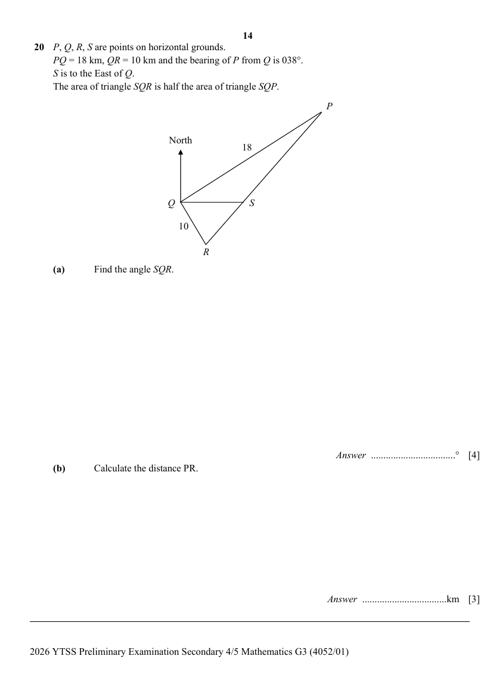

# Yishun Town Secondary School — Mathematics G3 4052/01 Paper 1 (cleaned)

> **Institution:** Yishun Town Secondary School
> **Exam:** Preliminary Examination 2026
> **Level:** Secondary 4/5
> **Subjects:** Mathematics G3
> **Paper:** 4052/01 Paper 1
> **Date:** 11 August 2026 (Tuesday)
> **Duration:** 2 h 15 min
> **Total Marks:** 90
> **Source:** `YTSS-2026-Emaths-Paper-1-With-Ans.pdf` (cleaned & reformatted)

---

## Instructions

Do not turn over the cover page until you are told to do so.
Write your name, class and class index number in the spaces at the top of this page.
Write in dark blue or black pen.
You may use a pencil for any diagrams or graphs.
Do not use staples, paper clips, highlighters, glue or correction fluid.

Answer all the questions.
If working is needed for any question it must be shown with the answer.
Omission of essential working will result in loss of marks.
The use of an approved scientific calculator is expected, where appropriate.
If the degree of accuracy is not specified in the question, and if the answer is not exact, give the answer to three significant figures. Give answers in degrees to one decimal place.
For $\pi$, use either your calculator value or $3.142$, unless the question requires the answer in terms of $\pi$.

The number of marks is given in brackets [ ] at the end of each question or part question.

The total of the marks for this paper is 90.

This question paper consists of 20 printed pages.

---

## Mathematical Formulae

*Compound interest*

$$
\text{Total amount} = P\left(1+\frac{r}{100}\right)^{n}
$$

*Mensuration*

$$
\text{Curved surface area of a cone} = \pi rl
$$

$$
\text{Surface area of a sphere} = 4\pi r^{2}
$$

$$
\text{Volume of a cone} = \frac{1}{3}\pi r^{2}h
$$

$$
\text{Volume of a sphere} = \frac{4}{3}\pi r^{3}
$$

$$
\text{Area of triangle } ABC = \frac{1}{2}ab\sin C
$$

$$
\text{Arc length} = r\theta,\text{ where }\theta\text{ is in radians}
$$

$$
\text{Sector area} = \frac{1}{2}r^{2}\theta,\text{ where }\theta\text{ is in radians}
$$

*Trigonometry*

$$
\frac{a}{\sin A} = \frac{b}{\sin B} = \frac{c}{\sin C}
$$

$$
a^{2} = b^{2}+c^{2}-2bc\cos A
$$

*Statistics*

$$
\text{Mean} = \frac{\sum fx}{\sum f}
$$

$$
\text{Standard deviation} = \sqrt{\frac{\sum fx^{2}}{\sum f}-\left(\frac{\sum fx}{\sum f}\right)^{2}}
$$

---

## Answer all the questions

### Q1

> **Marks:** 2
> **Topic:** N2 Ratio and proportion
> **Sub-topic:** Ratio and proportion
> **LO:** [[context/subjects/o-level-e-maths/learning-objectives/o-level-e-maths-N2d.md|N2d]]
> **Page:** 3

Abeny, Becky and Cassidy decided to invest money in the ratio of $p:2:6$.
Becky invested &#36;16 000 and Cassidy’s investment was 20% of the total investment.
Find the value of the total investment. [2]

---

### Q2

> **Marks:** (a) 2, (b) 1; total 3
> **Page:** 3

**(a)** Given that $\sin x^{\circ}=0.8524$, find the two possible values for angle $x$, where $0\leq x\leq 180$. [2]
> **Topic:** G4 Pythagoras' theorem and trigonometry
> **Sub-topic:** Pythagoras' theorem and trigonometry
> **LO:** [[context/subjects/o-level-e-maths/learning-objectives/o-level-e-maths-G4c.md|G4c]]

**(b)** Convert $1.54$ radians into degrees. [1]
> **Topic:** G4 Pythagoras' theorem and trigonometry
> **Sub-topic:** Pythagoras' theorem and trigonometry
> **LO:** [[context/subjects/o-level-e-maths/learning-objectives/o-level-e-maths-G4c.md|G4c]]

---

### Q3

> **Marks:** 1
> **Topic:** N2 Ratio and proportion
> **Sub-topic:** Ratio and proportion
> **LO:** [[context/subjects/o-level-e-maths/learning-objectives/o-level-e-maths-N2a.md|N2a]]
> **Page:** 3

The time taken to paint a wall is inversely proportional to the number of workers.
Five workers take 14 hours.
Find the number of hours it would take for 7 workers to paint the wall. [1]

---

### Q4

> **Marks:** 2
> **Topic:** N1 Numbers and their operations
> **Sub-topic:** Numbers and their operations
> **LO:** [[context/subjects/o-level-e-maths/learning-objectives/o-level-e-maths-N1j.md|N1j]]
> **Page:** 4

Given that $3^{4n-3}=3^{2026}-2\left(3^{2025}\right)$, find the value of $n$. [2]

---

### Q5

> **Marks:** 2
> **Topic:** N3 Percentage
> **Sub-topic:** Percentage
> **LO:** [[context/subjects/o-level-e-maths/learning-objectives/o-level-e-maths-N3d.md|N3d]]
> **Page:** 4

Mr Wong invested &#36;15000 in a savings account that offers 2% interest per annum, compounded every 3 months.
Calculate the total amount of interest Mr Wong earned at the end of 5 years. [2]

---

### Q6

> **Marks:** (a) 1, (b) 1; total 2
> **Page:** 5

**(a)** Given that $A=2^{n+2}\times 3^{4}\times 5^{5}$ and $B=2^{5}\times 3^{n-1}\times 7^{2}$ where $n$ is a positive integer.
The greatest common factor of $A$ and $B$ is 48.
Find the value of $n$. [1]
> **Topic:** N5 Algebraic expressions and formulae
> **Sub-topic:** Algebraic expressions and formulae
> **LO:** [[context/subjects/o-level-e-maths/learning-objectives/o-level-e-maths-N5h.md|N5h]]

**(b)** Explain why 1 is not a prime number. [1]
> **Topic:** N1 Numbers and their operations
> **Sub-topic:** Numbers and their operations
> **LO:** [[context/subjects/o-level-e-maths/learning-objectives/o-level-e-maths-N1b.md|N1b]]

---

### Q7

> **Marks:** 3
> **Topic:** N1 Numbers and their operations
> **Sub-topic:** Numbers and their operations
> **LO:** [[context/subjects/o-level-e-maths/learning-objectives/o-level-e-maths-N1j.md|N1j]]
> **Page:** 5

Explain why $3^{x+2}+5\left(\dfrac{1}{3}\right)^{-x}-4\sqrt{9}^{x}$ is divisible by 10 for all integer values of $x$. [3]

---

### Q8

> **Marks:** (a) 2, (b) 2; total 4
> **Page:** 6

**(a)** Factorise completely $2x^{2}+x-6$. [2]
> **Topic:** N5 Algebraic expressions and formulae
> **Sub-topic:** Algebraic expressions and formulae
> **LO:** [[context/subjects/o-level-e-maths/learning-objectives/o-level-e-maths-N5h.md|N5h]]

**(b)** Hence factorise completely $2(y-3)^{2}+(y+4)-13$.
Write your answer as simply as possible. [2]
> **Topic:** N5 Algebraic expressions and formulae
> **Sub-topic:** Algebraic expressions and formulae
> **LO:** [[context/subjects/o-level-e-maths/learning-objectives/o-level-e-maths-N5h.md|N5h]]

---

### Q9

> **Marks:** 2
> **Topic:** N3 Percentage
> **Sub-topic:** Percentage
> **LO:** [[context/subjects/o-level-e-maths/learning-objectives/o-level-e-maths-N3d.md|N3d]]
> **Page:** 6

Cheryl went to Europe for a holiday and bought a bag for 900 Euros.
She then sold the bag to her friend at a 15% profit.
Given that the conversion rate between Singapore dollars (&#36;) and Euros (€) was &#36;1 = 0.67 (€),
calculate the selling price in Singapore dollars (&#36;). [2]

---

### Q10

> **Marks:** 4
> **Topic:** G4 Pythagoras' theorem and trigonometry
> **Sub-topic:** Pythagoras' theorem and trigonometry
> **LO:** [[context/subjects/o-level-e-maths/learning-objectives/o-level-e-maths-G4g.md|G4g]]
> **Page:** 7

The diagram represents a building, $PQ$, built on horizontal ground.
The height of the building is 48 m.
From a point $R$, the angle of elevation of the top of the tower is $40^{\circ}$.
Point $S$ is 18 m from $R$ and $QRS$ is a straight line.
Calculate the angle of depression of point $S$ from the top of the building. [4]

---

### Q11

> **Marks:** 2
> **Topic:** G5 Mensuration
> **Sub-topic:** Mensuration
> **LO:** [[context/subjects/o-level-e-maths/learning-objectives/o-level-e-maths-G5c.md|G5c]]
> **Page:** 7

Alex has 168 one-centimetre cubes.
He arranges all the cubes into a cuboid.
The perimeter of the top of the cuboid is 26 cm.
Each side of the cuboid has a length greater than 2 cm.
Find the height of the cuboid. [2]

---

### Q12

> **Marks:** (a) 2, (b) 1; total 3
> **Page:** 8

**(a)** Express $x^{2}+6x+10$ in the form $(x+p)^{2}+q$, where $p$ and $q$ are constants to be found. [2]
> **Topic:** N6 Functions and graphs
> **Sub-topic:** Functions and graphs
> **LO:** [[context/subjects/o-level-e-maths/learning-objectives/o-level-e-maths-N6c.md|N6c]]

**(b)** Write down the coordinates of the minimum point of the graph of $y=x^{2}+6x+10$. [1]
> **Topic:** N6 Functions and graphs
> **Sub-topic:** Functions and graphs
> **LO:** [[context/subjects/o-level-e-maths/learning-objectives/o-level-e-maths-N6c.md|N6c]]

---

### Q13

> **Marks:** 3
> **Topic:** G6 Coordinate geometry
> **Sub-topic:** Coordinate geometry
> **LO:** [[context/subjects/o-level-e-maths/learning-objectives/o-level-e-maths-G6c.md|G6c]]
> **Page:** 8

The curve $y=ax^{2}+bx+c$ passes through the points $(-1,-16)$ and $(1,0)$.
The equation of the line of symmetry of the curve is $x=2$.
Find the values of $a$, $b$ and $c$. [3]

---

### Q14

> **Marks:** 3
> **Topic:** N1 Numbers and their operations
> **Sub-topic:** Numbers and their operations
> **LO:** [[context/subjects/o-level-e-maths/learning-objectives/o-level-e-maths-N1j.md|N1j]]
> **Page:** 9

Simplify $\left(\sqrt{\dfrac{16}{9x^{8}}}\right)^{-1}+\left(\dfrac{x^{5}}{32}\right)^{0.8}$. [3]

---

### Q15

> **Marks:** 3
> **Topic:** N5 Algebraic expressions and formulae
> **Sub-topic:** Algebraic expressions and formulae
> **LO:** [[context/subjects/o-level-e-maths/learning-objectives/o-level-e-maths-N5h.md|N5h]]
> **Page:** 9

Factorise completely $x^{3}-x^{2}y-xy^{2}+y^{3}$. [3]

---

### Q16

> **Marks:** (a) 3, (b) 3; total 6
> **Page:** 10

A bag contains $n$ red marbles and 2 blue marbles.
Three marbles are drawn from the bag at random, one after another without replacement.
The probability that three of the marbles drawn are red is $\dfrac{1}{5}$.

**(a)** Show that $n$ satisfies the equation $2n^{2}-9n+4=0$. [3]
> **Topic:** S2 Probability
> **Sub-topic:** Probability
> **LO:** [[context/subjects/o-level-e-maths/learning-objectives/o-level-e-maths-S2c.md|S2c]]

**(b)** Hence, find the probability that at least two marbles drawn are red. [3]
> **Topic:** S2 Probability
> **Sub-topic:** Probability
> **LO:** [[context/subjects/o-level-e-maths/learning-objectives/o-level-e-maths-S2c.md|S2c]]

---

### Q17

> **Marks:** (a) 1, (b) 1, (c) 1; total 3
> **Page:** 11

The diagram represents a plot of land, $ABCD$.

**(a)** Construct the perpendicular bisector of $AD$. [1]
> **Topic:** G2 Congruence and similarity
> **Sub-topic:** Congruence and similarity
> **LO:** [[context/subjects/o-level-e-maths/learning-objectives/o-level-e-maths-G2e.md|G2e]]

**(b)** Construct the bisector of angle $BAD$. [1]
> **Topic:** G2 Congruence and similarity
> **Sub-topic:** Congruence and similarity
> **LO:** [[context/subjects/o-level-e-maths/learning-objectives/o-level-e-maths-G2e.md|G2e]]

**(c)** A supermarket is to be built within $ABCD$, nearer to $AD$ than $AB$ and nearer to $A$ than $D$.
Shade the region where the supermarket is to be built. [1]
> **Topic:** G2 Congruence and similarity
> **Sub-topic:** Congruence and similarity
> **LO:** [[context/subjects/o-level-e-maths/learning-objectives/o-level-e-maths-G2e.md|G2e]]

---

### Q18

> **Marks:** (a) 1, (b) 2, (c) 1, (d) 2; total 6
> **Page:** 12–13

The mass of 80 students are measured and presented in the cumulative frequency diagram below.

Use the diagram to estimate

**(a)** the median mass of the students, [1]
> **Topic:** S1 Data handling and analysis
> **Sub-topic:** Data handling and analysis
> **LO:** [[context/subjects/o-level-e-maths/learning-objectives/o-level-e-maths-S1f.md|S1f]]

**(b)** the interquartile range of the mass, [2]
> **Topic:** S1 Data handling and analysis
> **Sub-topic:** Data handling and analysis
> **LO:** [[context/subjects/o-level-e-maths/learning-objectives/o-level-e-maths-S1i.md|S1i]]

**(c)** the percentage of students whose mass are at least 70 kg. [1]
> **Topic:** S1 Data handling and analysis
> **Sub-topic:** Data handling and analysis
> **LO:** [[context/subjects/o-level-e-maths/learning-objectives/o-level-e-maths-S1i.md|S1i]]

**(d)** One student is chosen at random.
Find the probability that the student’s mass is between 45 kg and 65 kg. [2]
> **Topic:** S1 Data handling and analysis
> **Sub-topic:** Data handling and analysis
> **LO:** [[context/subjects/o-level-e-maths/learning-objectives/o-level-e-maths-S1i.md|S1i]]

---

### Q19

> **Marks:** (a)(i) 1, (a)(ii) 1, (b) 1; total 3
> **Page:** 13

Two sets $P$ and $Q$ are such that $P\subset Q$.

**(a)** Fill in each box with one of the following:

$\varnothing$ $\cup$ $\cap$ $P$ $Q$ $P'$ $Q'$

**(i)** $(P\cap Q)\ \square\ (P'\cap Q)=Q$ [1]
> **Topic:** N8 Set language and notation
> **Sub-topic:** Set language and notation
> **LO:** [[context/subjects/o-level-e-maths/learning-objectives/o-level-e-maths-N8a.md|N8a]]

**(ii)** $(P'\cup Q)'=\ \square$ [1]
> **Topic:** N8 Set language and notation
> **Sub-topic:** Set language and notation
> **LO:** [[context/subjects/o-level-e-maths/learning-objectives/o-level-e-maths-N8a.md|N8a]]

**(b)** Andy claims “$A\cap B=\varnothing$, then $A\subset B'$.”
Do you agree with Andy?
Justify your answer with explanation. [1]
> **Topic:** N8 Set language and notation
> **Sub-topic:** Set language and notation
> **LO:** [[context/subjects/o-level-e-maths/learning-objectives/o-level-e-maths-N8a.md|N8a]]

---

### Q20

> **Marks:** (a) 4, (b) 3; total 7
> **Page:** 14

$P$, $Q$, $R$, $S$ are points on horizontal grounds.
$PQ=18$ km, $QR=10$ km and the bearing of $P$ from $Q$ is $038^{\circ}$.
$S$ is to the East of $Q$.
The area of triangle $SQR$ is half the area of triangle $SQP$.

**(a)** Find the angle $SQR$. [4]
> **Topic:** G4 Pythagoras' theorem and trigonometry
> **Sub-topic:** Pythagoras' theorem and trigonometry
> **LO:** [[context/subjects/o-level-e-maths/learning-objectives/o-level-e-maths-G4g.md|G4g]]

**(b)** Calculate the distance $PR$. [3]
> **Topic:** G4 Pythagoras' theorem and trigonometry
> **Sub-topic:** Pythagoras' theorem and trigonometry
> **LO:** [[context/subjects/o-level-e-maths/learning-objectives/o-level-e-maths-G4g.md|G4g]]

---

### Q21

> **Marks:** (a) 2, (b) 3; total 5
> **Page:** 15

In the diagram, $ABC$ is a triangle. $DF$ is parallel to $BC$ and $AC$ is parallel to $DE$.

**(a)** Prove that triangles $ADF$ and $ABC$ are similar.
Give a reason for each statement you make. [2]
> **Topic:** G2 Congruence and similarity
> **Sub-topic:** Congruence and similarity
> **LO:** [[context/subjects/o-level-e-maths/learning-objectives/o-level-e-maths-G2i.md|G2i]]

**(b)** Name two triangles that are congruent and show that they are congruent.
Give a reason for each statement you make. [3]
> **Topic:** G2 Congruence and similarity
> **Sub-topic:** Congruence and similarity
> **LO:** [[context/subjects/o-level-e-maths/learning-objectives/o-level-e-maths-G2i.md|G2i]]

---

### Q22

> **Marks:** (a)(i) 1, (a)(ii) 1, (a)(iii) 2, (b) 2, (c) 2; total 8
> **Page:** 16–17

In the diagram, $ABCD$ is a parallelogram.
Diagonals $AC$ and $BD$ intersect at $E$ and $G$ is the midpoint of $BE$.
$F$ is a point of $BC$ such that $\overrightarrow{BC}=3\overrightarrow{BF}$.
It is given that $\overrightarrow{BF}=\mathbf{a}$ and $\overrightarrow{CE}=\mathbf{b}$.

**(a)** Express each of the following vectors in terms of $\mathbf{a}$ and $\mathbf{b}$ as simply as possible.

**(i)** $\overrightarrow{BA}$ [1]
> **Topic:** G7 Vectors in two dimensions
> **Sub-topic:** Vectors in two dimensions
> **LO:** [[context/subjects/o-level-e-maths/learning-objectives/o-level-e-maths-G7h.md|G7h]]

**(ii)** $\overrightarrow{BD}$ [1]
> **Topic:** G7 Vectors in two dimensions
> **Sub-topic:** Vectors in two dimensions
> **LO:** [[context/subjects/o-level-e-maths/learning-objectives/o-level-e-maths-G7h.md|G7h]]

**(iii)** $\overrightarrow{AG}$ [2]
> **Topic:** G7 Vectors in two dimensions
> **Sub-topic:** Vectors in two dimensions
> **LO:** [[context/subjects/o-level-e-maths/learning-objectives/o-level-e-maths-G7h.md|G7h]]

**(b)** Show that points $A$, $G$ and $F$ are collinear. [2]
> **Topic:** G7 Vectors in two dimensions
> **Sub-topic:** Vectors in two dimensions
> **LO:** [[context/subjects/o-level-e-maths/learning-objectives/o-level-e-maths-G7h.md|G7h]]

**(c)** Find the value of $\dfrac{\text{area of }\triangle BFG}{\text{area of }ABCD}$. [2]
> **Topic:** G7 Vectors in two dimensions
> **Sub-topic:** Vectors in two dimensions
> **LO:** [[context/subjects/o-level-e-maths/learning-objectives/o-level-e-maths-G7h.md|G7h]]

---

### Q23

> **Marks:** (a) 2, (b) 3, (c) 1; total 6
> **Page:** 18–19

A closed container is in the shape of an inverted right pyramid with a rectangular base.
The dimensions of the base are $2L$ cm by $L$ cm and the vertical height of the pyramid is $H$ cm.
The container initially contains some water.
The volume of the water is $\dfrac{1}{27}$ of the total capacity of the container.

**(a)** Find the area of the rectangular surface of water, in terms of $L$. [2]
> **Topic:** G5 Mensuration
> **Sub-topic:** Mensuration
> **LO:** [[context/subjects/o-level-e-maths/learning-objectives/o-level-e-maths-G5b.md|G5b]]

**(b)** The container is now inverted so that the rectangular base is at the bottom. Given that the total vertical height of the pyramid $H$ is 90 cm, calculate the new height of the water.
Give your answers to 2 decimal places. [3]
> **Topic:** G5 Mensuration
> **Sub-topic:** Mensuration
> **LO:** [[context/subjects/o-level-e-maths/learning-objectives/o-level-e-maths-G5e.md|G5e]]

**(c)**

A new container is created, where it has a length $L$, and a vertical height of $\dfrac{1}{2}H$.
From the information given, Charles concludes that, “These two containers are similar solids.”
Justify with reason(s) if you agree with Charles claim. [1]
> **Topic:** G5 Mensuration
> **Sub-topic:** Mensuration
> **LO:** [[context/subjects/o-level-e-maths/learning-objectives/o-level-e-maths-G5e.md|G5e]]

---

### Q24

> **Marks:** (a) 1, (b) 1, (c) 2, (d) 1, (e) 2; total 7
> **Page:** 20

Tickets to a concert were sold. The seats were divided into 3 sectors, A, B and C.
On Friday, 56 Sector A tickets, 84 Sector B tickets and 78 Sector C tickets were sold.
On Saturday, 62 Sector A tickets, 76 Sector B tickets and 95 Sector C tickets were sold.

**(a)** Represent this information in a $2\times 3$ matrix, $E$. [1]
> **Topic:** N9 Matrices
> **Sub-topic:** Matrices
> **LO:** [[context/subjects/o-level-e-maths/learning-objectives/o-level-e-maths-N9b.md|N9b]]

**(b)** The price per ticket is &#36;20 for Sector A, &#36;15 for Sector B and &#36;12 for Sector C.
Write down a column matrix $F$ to represent the price per seat. [1]
> **Topic:** N9 Matrices
> **Sub-topic:** Matrices
> **LO:** [[context/subjects/o-level-e-maths/learning-objectives/o-level-e-maths-N9b.md|N9b]]

**(c)** Evaluate the matrix $G=EF$. [2]
> **Topic:** N9 Matrices
> **Sub-topic:** Matrices
> **LO:** [[context/subjects/o-level-e-maths/learning-objectives/o-level-e-maths-N9b.md|N9b]]

**(d)** State what each element of matrix $G$ represents. [1]
> **Topic:** N9 Matrices
> **Sub-topic:** Matrices
> **LO:** [[context/subjects/o-level-e-maths/learning-objectives/o-level-e-maths-N9b.md|N9b]]

**(e)** Using matrix multiplication, find the total amount of money collected from selling all of the tickets. [2]
> **Topic:** N9 Matrices
> **Sub-topic:** Matrices
> **LO:** [[context/subjects/o-level-e-maths/learning-objectives/o-level-e-maths-N9b.md|N9b]]

---

## Answers

Answer Key for 2026 YTSS 4G3 Prelims Mathematics P1

### Q1

> **Marks:** 2
> **Page:** 22

&#36;240000

---

### Q2

> **Marks:** (a) 2, (b) 1; total 3
> **Page:** 22

**(a)** $x=58.5^{\circ}$ or $x=121.5^{\circ}$

**(b)** $88.2^{\circ}$ (1 d.p.)

---

### Q3

> **Marks:** 1
> **Page:** 22

10

---

### Q4

> **Marks:** 2
> **Page:** 22

507

---

### Q5

> **Marks:** 2
> **Page:** 22

&#36;1573.43

---

### Q6

> **Marks:** (a) 1, (b) 1; total 2
> **Page:** 22

**(a)** 2

**(b)** Prime numbers have only 2 distinct factors but 1 only has 1 factor.

---

### Q7

> **Marks:** 3
> **Page:** 22

Since it is $3^{x}(10)$, 10 is a factor, it is divisible by 10.

---

### Q8

> **Marks:** (a) 2, (b) 2; total 4
> **Page:** 22

**(a)** $(2x-3)(x+2)$

**(b)** $(2y-9)(y-1)$

---

### Q9

> **Marks:** 2
> **Page:** 22

SGD1544.78

---

### Q10

> **Marks:** 4
> **Page:** 22

$32.5^{\circ}$

---

### Q11

> **Marks:** 2
> **Page:** 22

4

---

### Q12

> **Marks:** (a) 2, (b) 1; total 3
> **Page:** 22

**(a)** $(x+3)^{2}+1$

**(b)** $(-3,1)$

---

### Q13

> **Marks:** 3
> **Page:** 22

$a=-2$, $b=8$, $c=-6$

---

### Q14

> **Marks:** 3
> **Page:** 22

$\dfrac{13x^{4}}{16}$

---

### Q15

> **Marks:** 3
> **Page:** 22

$(x+y)(x-y)^{2}$

---

### Q16

> **Marks:** (a) 3, (b) 3; total 6
> **Page:** 22

**(a)**

$$
\frac{n}{n+2}\times\frac{n-1}{n+1}\times\frac{n-2}{n}=\frac{1}{5}
$$

$$
\frac{(n-1)(n-2)}{(n+2)(n+1)}=\frac{1}{5}
$$

$$
5(n-1)(n-2)=(n+2)(n+1)
$$

$$
5(n^{2}-3n+2)=n^{2}+3n+2
$$

$$
5n^{2}-15n+10=n^{2}+3n+2
$$

$$
4n^{2}-18n+8=0
$$

**(b)** $\dfrac{4}{5}$

---

### Q18

> **Marks:** (a) 1, (b) 2, (c) 1, (d) 2; total 6
> **Page:** 22

**(a)** 51

**(b)** 6

**(c)** 2.5%

**(d)** $\dfrac{17}{20}$

---

### Q19

> **Marks:** (a)(i) 1, (a)(ii) 1, (b) 1; total 3
> **Page:** 22

**(a)(i)** $(P\cap Q)\cup(P'\cap Q)=Q$

**(a)(ii)** $(P'\cup Q)'=\varnothing$

**(b)** I agree with Andy. Sets $A$ and $B$ are disjoint. $B'$ contains every element in the universal set that is not in $B$. $A$ has no elements in $B$ so every element of $A$ is in $B'$. Therefore, $A\subset B'$.

---

### Q20

> **Marks:** (a) 4, (b) 3; total 7
> **Page:** 22

**(a)** $45.2^{\circ}$ (1 d.p.)

**(b)** 21.7 km

---

### Q21

> **Marks:** (a) 2, (b) 3; total 5
> **Page:** 22

**(a)** Angle $ADF$ = Angle $ABC$ (corr angles, $DF//BC$)
Angle $DAF$ = Angle $BAC$ (Common angles)
By AA similarity test, triangle $ADF$ and triangle $ABC$ are similar.

**(b)** Angle $DFE$ = Angle $CEF$ (alt angles, $DF//CE$)
Angle $DEF$ = Angle $CFE$ (alt angles, $DE//CF$)
$EF=EF$ (Common side)
By ASA congruence test, triangle $CEF$ is congruent to triangle $DFE$.

---

### Q22

> **Marks:** (a)(i) 1, (a)(ii) 1, (a)(iii) 2, (b) 2, (c) 2; total 8
> **Page:** 22

**(a)(i)** $\overrightarrow{BA}=3\mathbf{a}+2\mathbf{b}$

**(a)(ii)** $\overrightarrow{BD}=6\mathbf{a}+2\mathbf{b}$

**(a)(iii)** $\overrightarrow{AG}=-\dfrac{3}{2}(\mathbf{a}+\mathbf{b})$

**(b)** Since $4\overrightarrow{AG}=3\overrightarrow{AF}$, $AG$ and $AF$ are parallel with A being the common point, A, G and F are on a straight line.

**(c)** $\dfrac{1}{24}$

---

### Q23

> **Marks:** (a) 2, (b) 3, (c) 1; total 6
> **Page:** 22

**(a)** $\dfrac{2}{9}L^{2}$

**(b)** 1.13 cm

**(c)** No, I do not agree as the width of the smaller container may not decrease proportionately thus it is inconclusive.

---

### Q24

> **Marks:** (a) 1, (b) 1, (c) 2, (d) 1, (e) 2; total 7
> **Page:** 22

**(a)**

$$
E=\begin{pmatrix}56&84&78\\62&76&95\end{pmatrix}
$$

**(b)**

$$
F=\begin{pmatrix}20\\15\\12\end{pmatrix}
$$

**(c)**

$$
G=\begin{pmatrix}3316\\3520\end{pmatrix}
$$

**(d)** $G$ represents the total amount of money collected through the sale of tickets for the concert on Friday and Saturday respectively.

**(e)** &#36;6836
