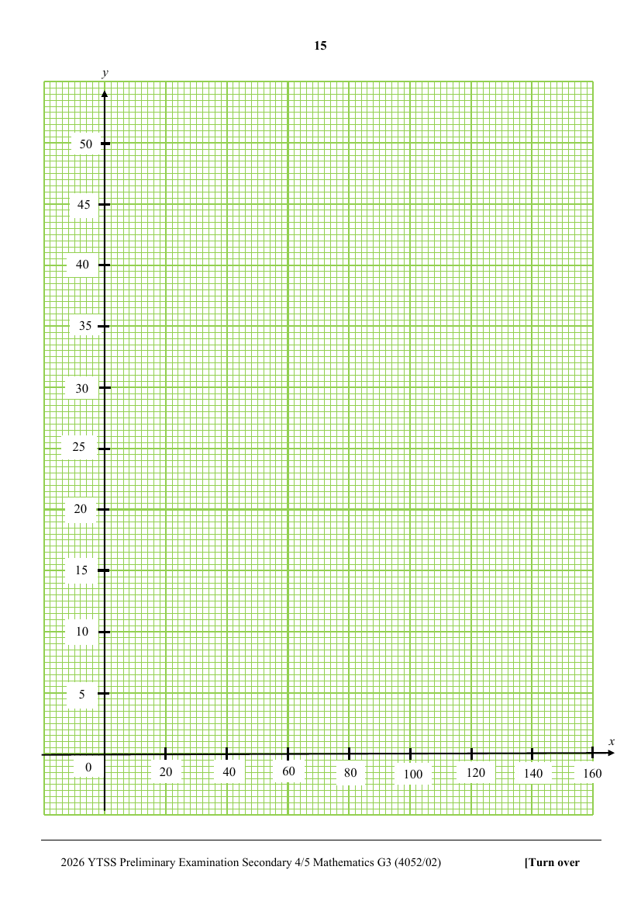
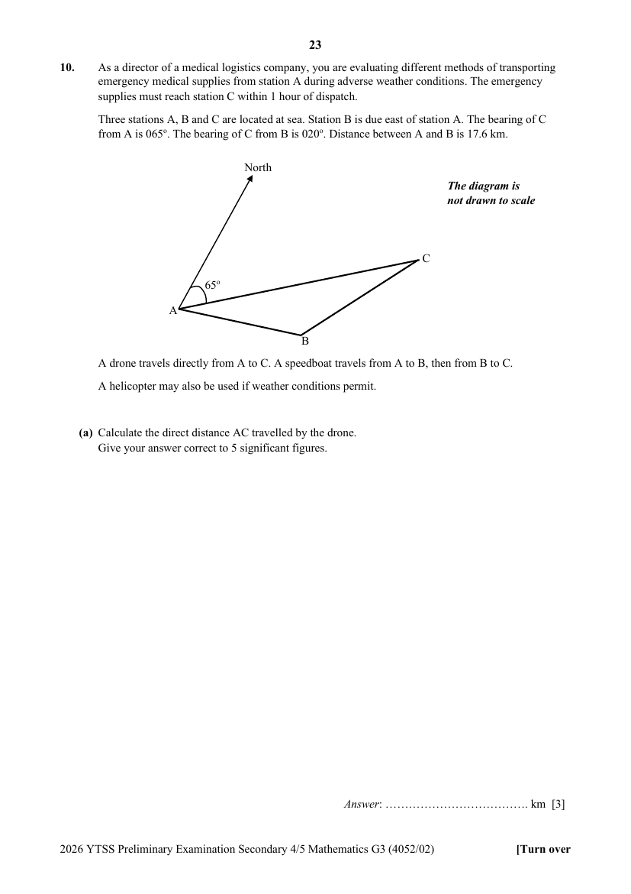

# Yishun Town Secondary School — Mathematics G3 4052/02 Paper 2 (cleaned)

> **Institution:** Yishun Town Secondary School
> **Exam:** Preliminary Examination 2026
> **Level:** Secondary 4/5
> **Subjects:** Mathematics G3
> **Paper:** 4052/02 Paper 2
> **Date:** 13 August 2026 (Thursday)
> **Duration:** 2 h 15 min
> **Total Marks:** 90
> **Source:** `YTSS-2026-Emaths-Paper-2-With-Ans.pdf` (cleaned & reformatted)

---

## Instructions

Do not turn over the cover page until you are told to do so.
Write your name, class and class index number in the spaces at the top of this page.
Write in dark blue or black pen.
You may use a pencil for any diagrams or graphs.
Do not use staples, paper clips, highlighters, glue or correction fluid.

Answer all the questions.
If working is needed for any question it must be shown with the answer.
Omission of essential working will result in loss of marks.
The use of an approved scientific calculator is expected, where appropriate.
If the degree of accuracy is not specified in the question, and if the answer is not exact, give the answer to three significant figures. Give answers in degrees to one decimal place.
For $\pi$, use either your calculator value or $3.142$, unless the question requires the answer in terms of $\pi$.

The number of marks is given in brackets [ ] at the end of each question or part question.

The total of the marks for this paper is 90.

This question paper consists of 24 printed pages and 2 blank pages.

---

## Mathematical Formulae

*Compound interest*

$$
\text{Total amount} = P\left(1+\frac{r}{100}\right)^{n}
$$

*Mensuration*

$$
\text{Curved surface area of a cone} = \pi rl
$$

$$
\text{Surface area of a sphere} = 4\pi r^{2}
$$

$$
\text{Volume of a cone} = \frac{1}{3}\pi r^{2}h
$$

$$
\text{Volume of a sphere} = \frac{4}{3}\pi r^{3}
$$

$$
\text{Area of a triangle } ABC = \frac{1}{2}ab\sin C
$$

$$
\text{Arc length} = r\theta,\text{ where }\theta\text{ is in radians}
$$

$$
\text{Sector area} = \frac{1}{2}r^{2}\theta,\text{ where }\theta\text{ is in radians}
$$

*Trigonometry*

$$
\frac{a}{\sin A} = \frac{b}{\sin B} = \frac{c}{\sin C}
$$

$$
a^{2} = b^{2}+c^{2}-2bc\cos A
$$

*Statistics*

$$
\text{Mean} = \frac{\sum fx}{\sum f}
$$

$$
\text{Standard deviation} = \sqrt{\frac{\sum fx^{2}}{\sum f}-\left(\frac{\sum fx}{\sum f}\right)^{2}}
$$

---

## Answer all the questions

### Q1

> **Marks:** (a) 5, (b) 3, (c)(i) 1, (c)(ii) 3; total 12
> **Page:** 3–5

**(a)** Solve the equation $\dfrac{x+7}{x^{2}-9}=-2+\dfrac{1}{3-x}$.

Give your solutions correct to 2 decimal places. [5]
> **Topic:** N7 Equations and inequalities
> **Sub-topic:** Equations and inequalities
> **LO:** [[context/subjects/o-level-e-maths/learning-objectives/o-level-e-maths-N7e.md|N7e]]

**(b)** Solve the inequalities $\dfrac{2}{3}+y\leq 9+\dfrac{4}{9}y<4+y$. [3]
> **Topic:** N7 Equations and inequalities
> **Sub-topic:** Equations and inequalities
> **LO:** [[context/subjects/o-level-e-maths/learning-objectives/o-level-e-maths-N7g.md|N7g]]

**(c)** Given that $\dfrac{1}{2}b=\sqrt{\dfrac{4-z}{z}+3}$,

**(i)** Find $b$ when $z=2$, [1]
> **Topic:** N5 Algebraic expressions and formulae
> **Sub-topic:** Algebraic expressions and formulae
> **LO:** [[context/subjects/o-level-e-maths/learning-objectives/o-level-e-maths-N5l.md|N5l]]

**(ii)** Rearrange the formula to make $z$ the subject. [3]
> **Topic:** N5 Algebraic expressions and formulae
> **Sub-topic:** Algebraic expressions and formulae
> **LO:** [[context/subjects/o-level-e-maths/learning-objectives/o-level-e-maths-N5k.md|N5k]]

---

### Q2

> **Marks:** (a)(i) 1, (a)(ii) 1, (b) 1, (c) 3; total 6
> **Page:** 6–7

YTSS is testing two AI systems, System A and System B, tracking their response times (in seconds) to student queries.

The response times for System A are shown below:

System A

| Stem | Leaf |
| --- | --- |
| 3 | 8 9 |
| 4 | 1 2 5 7 |
| 5 | 0 3 6 |
| 6 | 2 4 |

Key: 4 | 2 represents 42 seconds

**(a)(i)** Find the median response time for System A. [1]

**(a)(ii)** Find the standard deviation of the response times for System A. [1]

The following information is shown for System B:

System B

- Minimum = 35
- Lower Quartile = 40
- Median = 48
- Upper Quartile = 55
- Maximum = 70

**(b)** Construct a box-and-whisker plot for System B using the data provided. [1]
> **Topic:** S1 Data handling and analysis
> **Sub-topic:** Data handling and analysis
> **LO:** [[context/subjects/o-level-e-maths/learning-objectives/o-level-e-maths-S1i.md|S1i]]

**(c)** One student claims:

“System A is more consistent, but System B is faster.”

State whether you agree with this claim. Justify your answer using statistical measures. [3]
> **Topic:** S1 Data handling and analysis
> **Sub-topic:** Data handling and analysis
> **LO:** [[context/subjects/o-level-e-maths/learning-objectives/o-level-e-maths-S1i.md|S1i]]

---

### Q3

> **Marks:** (a) 2, (b) 2, (c) 2; total 6
> **Page:** 8–9

$A$, $B$, $C$, $D$ and $F$ are points on a circle in the diagram above, $O$ is the centre of the circle.

Line $AE$ meets line $OC$ at $O$.
The line $AF$ cuts the line $DC$ at $P$.
The ratio of angle $AOC$ to angle $ABC$ is $4:3$.

**(a)** Show that the angle $AFC$ is $72^{\circ}$. Give a reason for each step of your working. [2]
> **Topic:** G3 Properties of circles
> **Sub-topic:** Properties of circles
> **LO:** [[context/subjects/o-level-e-maths/learning-objectives/o-level-e-maths-G3b.md|G3b]]

**(b)** Find the perimeter of the major sector $ADFC$, given that the diameter of the circle with centre $O$ is 11cm. [2]
> **Topic:** G3 Properties of circles
> **Sub-topic:** Properties of circles
> **LO:** [[context/subjects/o-level-e-maths/learning-objectives/o-level-e-maths-G3b.md|G3b]]

**(c)** Another circle is drawn on the diagram such that line $AD$ is its diameter.
Determine whether point $E$ lies on its circumference if $\angle DAO=18^{\circ}$.
Give reasons for each statement you make. [2]
> **Topic:** G3 Properties of circles
> **Sub-topic:** Properties of circles
> **LO:** [[context/subjects/o-level-e-maths/learning-objectives/o-level-e-maths-G3b.md|G3b]]

---

### Q4

> **Marks:** (a) 2, (b) 2, (c)(i) 2, (c)(ii) 2; total 8
> **Page:** 10–11

Solutions to this question by accurate drawing will not be accepted.

The diagram below shows 4 points, $A$, $B$, $C$ and $D$.

Points $B$ and $D$ lies on the $x$-axis and point $C$ lies on the $y$-axis.
$B$ is the point $(2, 0)$ and $AB$ intersects the $y$-axis at 1.

It is given further that $BC$ is parallel to $AD$ and the equation of the line $AD$ is $y-4-x=0$.

**(a)** Find the equation of the line $AB$. [2]
> **Topic:** G6 Coordinate geometry
> **Sub-topic:** Coordinate geometry
> **LO:** [[context/subjects/o-level-e-maths/learning-objectives/o-level-e-maths-G6c.md|G6c]]

**(b)** Show that the coordinates of $A$ are $(-2, 2)$. [2]

**(c)(i)** Find distance $AC$. [2]

**(c)(ii)** Find the shortest distance from $B$ to $AC$ given that the area of $ABC$ is 6 units$^{2}$. [2]
> **Topic:** G6 Coordinate geometry
> **Sub-topic:** Coordinate geometry
> **LO:** [[context/subjects/o-level-e-maths/learning-objectives/o-level-e-maths-G6c.md|G6c]]

---

### Q5

> **Marks:** (a)(i) 1, (a)(ii) 1, (a)(iii) 2, (b)(i) 1, (b)(ii) 1, (b)(iii) 1; total 7
> **Page:** 12–13

**(a)** The first four terms in a sequence are 5, 8, 11 and 14.

**(i)** Find the fifth term of the sequence. [1]
> **Topic:** N5 Algebraic expressions and formulae
> **Sub-topic:** Algebraic expressions and formulae
> **LO:** [[context/subjects/o-level-e-maths/learning-objectives/o-level-e-maths-N5e.md|N5e]]

**(ii)** $T_{n}$ is the $n$th term of the sequence.

Find an expression, in terms of $n$, for $T_{n}$. [1]
> **Topic:** N5 Algebraic expressions and formulae
> **Sub-topic:** Algebraic expressions and formulae
> **LO:** [[context/subjects/o-level-e-maths/learning-objectives/o-level-e-maths-N5e.md|N5e]]

**(iii)** $T_{n}^{2}-T_{n}$ is a positive integer.
Show that $T_{n}^{2}-T_{n}$ is a multiple of 3 for $n\geq a$. Hence, state the value of $a$. [2]

**(b)(i)** The first four terms in a different sequence are

$$
\frac{5}{1},\ \frac{8}{4},\ \frac{11}{9},\ \frac{14}{16}
$$

Find $P_{n}$, the $n$th term of this sequence. [1]

**(b)(ii)** Jenna states that $\dfrac{110}{289}$ is a term in the above sequence.
Do you agree with her? Show your working clearly. [1]

**(b)(iii)** Explain why $P_{n}\leq 5$ for all values of $n$. [1]
> **Topic:** N5 Algebraic expressions and formulae
> **Sub-topic:** Algebraic expressions and formulae
> **LO:** [[context/subjects/o-level-e-maths/learning-objectives/o-level-e-maths-N5e.md|N5e]]

---

### Q6

> **Marks:** (a) 1, (b) 2, (c) 1, (d) 2, (e)(i) 1, (e)(ii) 1; total 8
> **Page:** 14–15

The cost, $y$ dollars, of printing each T-shirt when $x$ T-shirts are printed is modelled by the equation $y=8+\dfrac{400}{x}$, for $10\leq x\leq 160$.
Some corresponding values of $x$ and $y$ are given in the table below.

| $x$ | 10 | 20 | 50 | 80 | 125 | 160 |
| --- | --- | --- | --- | --- | --- | --- |
| $y$ | 48 | 28 | 16 | 13 | 11.2 | $p$ |

**(a)** Find the value of $p$ in the table above. [1]
> **Topic:** N6 Functions and graphs
> **Sub-topic:** Functions and graphs
> **LO:** [[context/subjects/o-level-e-maths/learning-objectives/o-level-e-maths-N6j.md|N6j]]

**(b)** On the grid opposite, draw the graph of $y=8+\dfrac{400}{x}$ for $10\leq x\leq 160$. [2]
> **Topic:** N6 Functions and graphs
> **Sub-topic:** Functions and graphs
> **LO:** [[context/subjects/o-level-e-maths/learning-objectives/o-level-e-maths-N6c.md|N6c]]

**(c)** Use your graph to estimate the number of T-shirts that is printed if the cost of printing each T-shirt is &#36;20. [1]
> **Topic:** N6 Functions and graphs
> **Sub-topic:** Functions and graphs
> **LO:** [[context/subjects/o-level-e-maths/learning-objectives/o-level-e-maths-N6c.md|N6c]]

**(d)** By drawing a tangent, find the gradient of the curve at $(40, 18)$. [2]
> **Topic:** G6 Coordinate geometry
> **Sub-topic:** Coordinate geometry
> **LO:** [[context/subjects/o-level-e-maths/learning-objectives/o-level-e-maths-G6c.md|G6c]]

**(e)** John suggests that the selling price of each T-shirt, in dollars, is modelled by $y=30-\dfrac{3}{16}x$.

**(i)** On the same grid, draw the graph of $y=30-\dfrac{3}{16}x$ for $0\leq x\leq 160$. [1]
> **Topic:** N6 Functions and graphs
> **Sub-topic:** Functions and graphs
> **LO:** [[context/subjects/o-level-e-maths/learning-objectives/o-level-e-maths-N6j.md|N6j]]

**(ii)** Using your graphs, determine the range of values of $x$ for which John will not make any loss, assuming that all of the t-shirts will be sold. [1]
> **Topic:** N6 Functions and graphs
> **Sub-topic:** Functions and graphs
> **LO:** [[context/subjects/o-level-e-maths/learning-objectives/o-level-e-maths-N6j.md|N6j]]

---

### Q7

> **Marks:** (a)(i) 3, (a)(ii) 3, (b)(i) 2, (b)(ii) 2; total 10
> **Page:** 16–17

**(a)** $A$, $B$, $C$ and $E$ are four vertices of a $n$-sided polygon and reflex angle $ABC$ is $190^{\circ}$.
The remaining reflex angles of the $n$-sided polygon are each equal to $205^{\circ}$.
A regular pentagon $CDEFG$ is placed such that one of its diagonal $CE$, is also one of the sides of the $n$-sided polygon.

**(i)** Find $\angle BCD$. [3]
> **Topic:** G1 Angles, triangles and polygons
> **Sub-topic:** Angles, triangles and polygons
> **LO:** [[context/subjects/o-level-e-maths/learning-objectives/o-level-e-maths-G1f.md|G1f]]

**(ii)** Find the number of sides of the $n$-sided polygon. [3]
> **Topic:** G1 Angles, triangles and polygons
> **Sub-topic:** Angles, triangles and polygons
> **LO:** [[context/subjects/o-level-e-maths/learning-objectives/o-level-e-maths-G1f.md|G1f]]

**(b)** In the diagram below, $AB$, $CD$ and $EF$ are parallel lines. $XWV$ and $XYZ$ are straight lines.
The line $XZ$ bisects angle $BXW$ and $\angle VWY=106^{\circ}$.

**(i)** Show that $WXY$ is an isosceles triangle. Give reasons for your working. [2]
> **Topic:** G1 Angles, triangles and polygons
> **Sub-topic:** Angles, triangles and polygons
> **LO:** [[context/subjects/o-level-e-maths/learning-objectives/o-level-e-maths-G1f.md|G1f]]

**(ii)** Which is the longest side of the triangle $XVZ$? Show all your necessary workings. [2]
> **Topic:** G1 Angles, triangles and polygons
> **Sub-topic:** Angles, triangles and polygons
> **LO:** [[context/subjects/o-level-e-maths/learning-objectives/o-level-e-maths-G1f.md|G1f]]

---

### Q8

> **Marks:** (a)(i) 2, (a)(ii) 2, (a)(iii) 2, (b) 2, (c)(i) 2, (c)(ii) 2; total 12
> **Page:** 18–19

**(a)** The table shows the number of messages sent per month from June to September in 2023 in Singapore.

| Month | June | July | Aug | Sep |
| --- | --- | --- | --- | --- |
| Number of days | 30 | 31 | 31 | 30 |
| Number of messages sent | $9.88\times 10^{12}$ | $8.3\times 10^{11}$ | $5.97\times 10^{11}$ | $9.11\times 10^{12}$ |

**(i)** The population of Singapore in 2023 was $5.12\times 10^{9}$.
Calculate the mean number of messages sent per person per day from June to September in 2023. [2]
> **Topic:** N2 Ratio and proportion
> **Sub-topic:** Ratio and proportion
> **LO:** [[context/subjects/o-level-e-maths/learning-objectives/o-level-e-maths-N2c.md|N2c]]

**(ii)** Calculate the percentage decrease in the number of messages sent from July to August. [2]
> **Topic:** N2 Ratio and proportion
> **Sub-topic:** Ratio and proportion
> **LO:** [[context/subjects/o-level-e-maths/learning-objectives/o-level-e-maths-N2c.md|N2c]]

**(iii)** The number of messages sent in 2025 from June to September was 12.2% more than the number of messages sent in 2023 from June to September.

Calculate the number of number of messages sent in 2025. Give your answer in standard form. [2]
> **Topic:** N2 Ratio and proportion
> **Sub-topic:** Ratio and proportion
> **LO:** [[context/subjects/o-level-e-maths/learning-objectives/o-level-e-maths-N2c.md|N2c]]

**(b)** In 2023, Singapore has a population of 5.64 million.
The land area of Singapore was 728.6 km$^{2}$.
Find the population of Singapore per km$^{2}$, leaving your answer as standard form. [2]
> **Topic:** N2 Ratio and proportion
> **Sub-topic:** Ratio and proportion
> **LO:** [[context/subjects/o-level-e-maths/learning-objectives/o-level-e-maths-N2c.md|N2c]]

**(c)** The area of the reserve on a map is 24 cm$^{2}$, while its actual area is 6 km$^{2}$.

**(i)** Find the scale of the map in the form $1:n$. [2]
> **Topic:** N2 Ratio and proportion
> **Sub-topic:** Ratio and proportion
> **LO:** [[context/subjects/o-level-e-maths/learning-objectives/o-level-e-maths-N2c.md|N2c]]

**(ii)** The scale of the map in (i) is reduced to $1:25\ 000$.

Show your working clearly to determine whether the area of the reserve shown on the new map is doubled, quadrupled or remains unchanged. [2]
> **Topic:** N2 Ratio and proportion
> **Sub-topic:** Ratio and proportion
> **LO:** [[context/subjects/o-level-e-maths/learning-objectives/o-level-e-maths-N2c.md|N2c]]

---

### Q9

> **Marks:** (a) 1, (b) 3, (c) 3, (d) 4; total 11
> **Page:** 20–21

The diagram shows a metal buoy. It is made up of a cone and a hemisphere. The cone is mounted on the base of a hemisphere with a radius of 0.6 m.

Given that the slant height of the cone is 1 m,

**(a)** Show that the height of the buoy is 1.4 m. [1]
> **Topic:** G5 Mensuration
> **Sub-topic:** Mensuration
> **LO:** [[context/subjects/o-level-e-maths/learning-objectives/o-level-e-maths-G5g.md|G5g]]

**(b)** Calculate the total surface area of the buoy. [3]
> **Topic:** G5 Mensuration
> **Sub-topic:** Mensuration
> **LO:** [[context/subjects/o-level-e-maths/learning-objectives/o-level-e-maths-G5c.md|G5c]]

**(c)** Calculate the volume of the buoy, leaving your answer in terms of $\pi$. [3]
> **Topic:** G5 Mensuration
> **Sub-topic:** Mensuration
> **LO:** [[context/subjects/o-level-e-maths/learning-objectives/o-level-e-maths-G5c.md|G5c]]

**(d)** The buoy shown in Figure 1 is melted and recast into the prism shown below.
The prism has height 1.5 m, and its cross-section is the sector $OAB$, where angle $AOB$ is $\dfrac{11\pi}{30}$ radians. Assuming no material is lost during the recasting process, find the radius of the sector.

[4]
> **Topic:** G5 Mensuration
> **Sub-topic:** Mensuration
> **LO:** [[context/subjects/o-level-e-maths/learning-objectives/o-level-e-maths-G5g.md|G5g]]

---

### Q10

> **Marks:** (a) 3, (b) 7; total 10
> **Page:** 23–26

As a director of a medical logistics company, you are evaluating different methods of transporting emergency medical supplies from station A during adverse weather conditions. The emergency supplies must reach station C within 1 hour of dispatch.
Three stations A, B and C are located at sea. Station B is due east of station A. The bearing of C from A is $065^{\circ}$. The bearing of C from B is $020^{\circ}$. Distance between A and B is 17.6 km.

The diagram is not drawn to scale.

A drone travels directly from A to C. A speedboat travels from A to B, then from B to C.
A helicopter may also be used if weather conditions permit.

**(a)** Calculate the direct distance $AC$ travelled by the drone.
Give your answer correct to 5 significant figures. [3]
> **Topic:** G4 Pythagoras' theorem and trigonometry
> **Sub-topic:** Pythagoras' theorem and trigonometry
> **LO:** [[context/subjects/o-level-e-maths/learning-objectives/o-level-e-maths-G4g.md|G4g]]

The company collected the following operational data during a trial run.

| Vehicle | Maximum Speed | Actual Operating Speed | Further Information | Operating Cost |
| --- | --- | --- | --- | --- |
| Drone | 26 m/s | 19 m/s due to strong wind | 5 mins preparation time (loading and take-off); 42 mins maximum flying time; 8 kg maximum carrying load | &#36;1380 |
| Speedboat | 45 km/h | 40 km/h from A to B; 29 km/h from B to C due to rough sea conditions | 11 mins for docking and refuelling time at B | &#36;860 |
| Helicopter | 160 km/h | 150 km/h | 18 mins landing clearance and safety checks. For safety reasons, helicopter operations are suspended if visibility falls below the minimum requirement of 1.8 km at any point during the journey. | &#36;2390 |

The following information is further provided:

- Current visibility fluctuates between 1.3 km and 2.0 km.
- Medical supply is 7.2 kg.
- The drone system will only be approved if BOTH conditions below are satisfied.

Condition 1: The drone must reduce the total delivery time by at least 50% relative to the current speedboat operation.
Condition 2: The operating cost of drone per minute should not exceed the operating cost of the speedboat per minute by &#36;50.

**(b)** The company may choose either one of the 3 transportation methods. The company wants the fastest transportation method while keeping total operating cost to be below &#36;2400.

Determine which transportation method should be selected. You must show all relevant calculations and justify your conclusion clearly (other than the conditions stated above). State one assumption made in your working. [7]
> **Topic:** G4 Pythagoras' theorem and trigonometry
> **Sub-topic:** Pythagoras' theorem and trigonometry
> **LO:** [[context/subjects/o-level-e-maths/learning-objectives/o-level-e-maths-G4g.md|G4g]]

---

## Answers

Answer Key for 2026 YTSS 4G3 Prelims Mathematics P2

### Q1

> **Marks:** (a) 5, (b) 3, (c)(i) 1, (c)(ii) 3; total 12
> **Page:** 27

**(a)** $1.56$, $-2.56$

**(b)** $9<y\leq 15$

**(c)(i)** 4

**(c)(ii)** $z=\dfrac{16}{b^{2}-8}$

---

### Q2

> **Marks:** (a)(i) 1, (a)(ii) 1, (b) 1, (c) 3; total 6
> **Page:** 27

**(a)(i)** 47

**(a)(ii)** 8.60

**(c)** IQR_A $=56-41=15$
IQR_B $=55-40=15$
I disagree. System A is faster as the median as the median response time of 47secs is lower than system B’s median which is at 48 seconds.
Both systems are consistent in their data as their IQR is the same.

---

### Q3

> **Marks:** (a) 2, (b) 2, (c) 2; total 6
> **Page:** 27

**(b)** 31.7

**(c)** Point E lies on the circumference.

---

### Q4

> **Marks:** (a) 2, (b) 2, (c)(i) 2, (c)(ii) 2; total 8
> **Page:** 27

**(a)** $y=-\dfrac{1}{2}x+1$

**(c)(i)** 4.47 units

**(c)(ii)** 2.68 units

---

### Q5

> **Marks:** (a)(i) 1, (a)(ii) 1, (a)(iii) 2, (b)(i) 1, (b)(ii) 1, (b)(iii) 1; total 7
> **Page:** 27

**(a)(i)** 17

**(a)(ii)** $3n+2$

**(a)(iii)** $a=2$

**(b)(i)** $\dfrac{3n+2}{n^{2}}$

**(b)(ii)** Value of $n=17/2$ or $-34/55$
Since $n$ is not a positive integer, $110/289$ is not a term in sequence

**(b)(iii)** $n^{2}$ increases faster than $3n+2$, as $n$ increases, $P_{n}$ tends to 0.
As $n\geq 1$, $P_{n}\leq \dfrac{3}{1}+\dfrac{2}{1^{2}}\leq 5$

---

### Q6

> **Marks:** (a) 1, (b) 2, (c) 1, (d) 2, (e)(i) 1, (e)(ii) 1; total 8
> **Page:** 27

**(a)** 10.5

**(c)** 34

**(d)** $-0.25$

**(e)(ii)** $23\leq x\leq 94$

---

### Q7

> **Marks:** (a)(i) 3, (a)(ii) 3, (b)(i) 2, (b)(ii) 2; total 10
> **Page:** 27

**(a)(i)** $119^{\circ}$

**(a)(ii)** $n=15$

**(b)(i)** $\angle BXZ=\angle VXZ$ (line $XZ$ bisects angle $BXW$)
$\angle BXY=\angle XYW$ (alt.angles, $AB//CD$)
Hence $\angle WXY=\angle XYW$ (base angle of isoceles triangle)

**(b)(ii)** Angle $XVZ=180^{\circ}-106^{\circ}=74^{\circ}$. (int angle, $CD//EF$)
Angle $BXZ=$ Angle $XZV=53^{\circ}$. (alt angle, $AB//EF$)
$XZ$ is the largest side of the triangle as it is opposite the largest angle.

---

### Q8

> **Marks:** (a)(i) 2, (a)(ii) 2, (a)(iii) 2, (b) 2, (c)(i) 2, (c)(ii) 2; total 12
> **Page:** 27

**(a)(i)** 32.7

**(a)(ii)** 28.1%

**(a)(iii)** $2.29\times 10^{13}$

**(b)** $7.74\times 10^{3}$

**(c)(i)** $1:50\ 000$

**(c)(ii)** The area of the reserve shown on the new map is quadrupled.

---

### Q9

> **Marks:** (a) 1, (b) 3, (c) 3, (d) 4; total 11
> **Page:** 27

**(a)** Height $=\sqrt{1^{2}-0.6^{2}}=0.8$
$0.8+0.6=1.4$ (shown)

**(b)** 4.15

**(c)** $\dfrac{6}{25}\pi$

**(d)** $r=0.934$

---

### Q10

> **Marks:** (a) 3, (b) 7; total 10
> **Page:** 25–27

**(a)** 23.389 km

**(b)** Drone should be chosen.

$19\text{ m/s}=68.4\text{ km/h}$

Time taken from A to C for the drone:

$$
\frac{23.389}{68.4}=20.516\text{ min}
$$

Total time taken $=20.516+5=25.516$ mins ($<42$ mins)

$$
\frac{BC}{\sin 25^{\circ}}=\frac{17.6}{\sin 45^{\circ}}
$$

$$
BC=10.519\text{ km}
$$

Time taken from A to B for the speedboat: $\dfrac{17.6}{40}=26.4$ mins

Time taken from B to C: $\dfrac{10.519}{29}=21.763$ mins

Total time taken $=26.4+21.763+11=59.163$ mins

Percentage time reduction:

$$
\frac{59.163-25.516}{59.163}\times 100\%=56\%
$$

Additional &#36; per min:

$$
\frac{1380-860}{59.163-25.516}=15.45
$$

The drone system should be selected as:

- can deliver the package within 1 hour
- total cost is below &#36;2400
- it is faster compared to the speedboat.
- More reliable than the helicopter given the adverse weather conditions.

Helicopter is not selected as the visibility is not consistently above 1.8 km for the current situation.

Other acceptable assumptions given:

- The drone travels in a linear pathway
- The vehicles travel at constant speed
- The drone is assumed to maintain stable GPS connection throughout
